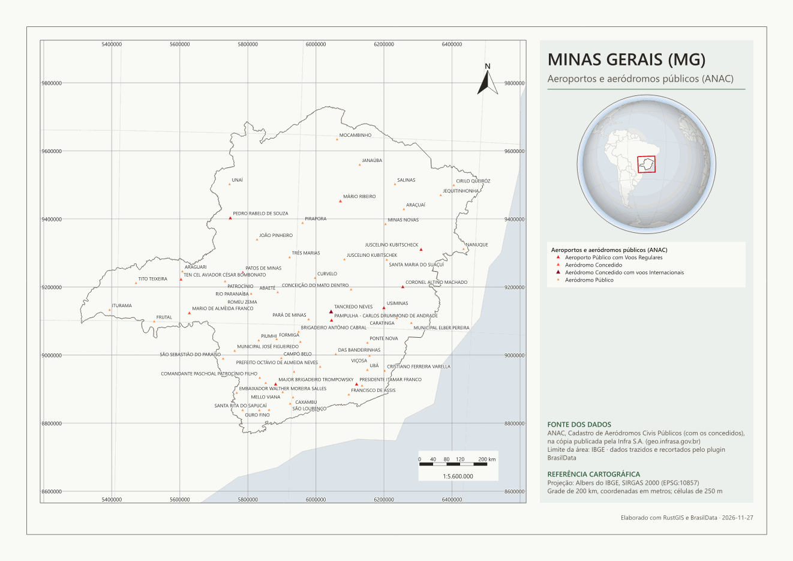

# Aeroportos e aeródromos públicos (ANAC)

<!-- Gerado por scripts/gerar.py a partir do fontes.csv e do fichas.csv; não edite à mão. -->

Os aeroportos e aeródromos públicos do Brasil, do Cadastro de Aeródromos da ANAC: os com voos internacionais, os com voos regulares, os concedidos e os demais aeródromos públicos (505 no país).

*Mapa exemplo: Minas Gerais, feito com o plugin.*

| | |
|---|---|
| **Onde na aba** | Infraestrutura › Transportes |
| **Fonte** | ANAC |
| **Período** | o cadastro na cópia da Infra S.A. (consultada em 27/11/2026). |
| **Resolução ou escala** | pontos (a posição do aeródromo) |
| **Unidades** | sem unidade |
| **Legenda** | Triângulos pelo tipo: vinho os com voos internacionais, vermelho os com voos regulares, laranja os concedidos e os demais aeródromos públicos; o nome como rótulo. Campos: nome, tipo, código OACI, código CIAD, município e UF. |
| **Cuidados de uso** | Só os públicos: os aeródromos privados (milhares de pistas de fazendas) não entram. Para o movimento de passageiros e de carga, os anuários da ANAC. |
| **Licença** | não declarada no serviço |
| **Citação** | ANAC, Cadastro de Aeródromos Civis Públicos (com os concedidos), na cópia publicada pela Infra S.A. (geo.infrasa.gov.br). |
| **App desktop** | sim |
| **App web** | sim |

[Todas as camadas](README.md)
