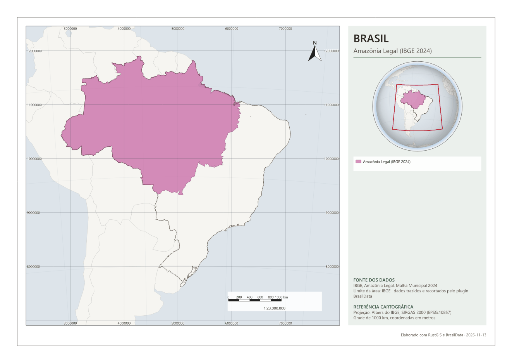

# Amazônia Legal (IBGE 2024)

<!-- Gerado por scripts/gerar.py a partir do fontes.csv e do fichas.csv; não edite à mão. -->

A Amazônia Legal, a região de atuação da SUDAM definida em lei (os estados do Norte, Mato Grosso e parte do Maranhão).

*Mapa exemplo: Brasil, feito com o plugin.*

| | |
|---|---|
| **Onde na aba** | Território › Recortes especiais |
| **Fonte** | IBGE |
| **Período** | limites de 2024, na Malha Municipal |
| **Resolução ou escala** | escala 1:250.000 |
| **Unidades** | sem unidade |
| **Legenda** | Um polígono. |
| **Cuidados de uso** | Recorte legal ou estatístico definido por lei ou pelo IBGE; vem só a parte dentro da área. |
| **Licença** | uso livre com citação da fonte |
| **Citação** | IBGE, Amazônia Legal, Malha Municipal 2024. |
| **App desktop** | sim |
| **App web** | sim |

[Todas as camadas](README.md)
