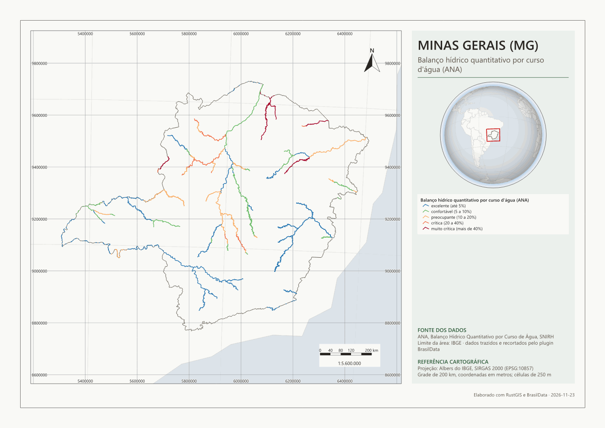

# Balanço hídrico quantitativo por curso d'água (ANA)

<!-- Gerado por scripts/gerar.py a partir do fontes.csv e do fichas.csv; não edite à mão. -->

O balanço hídrico quantitativo por curso d'água: a demanda de água em relação à disponibilidade, que indica onde há criticidade.

*Mapa exemplo: Minas Gerais, feito com o plugin.*

| | |
|---|---|
| **Onde na aba** | Água › Recursos hídricos |
| **Fonte** | ANA |
| **Período** | balanço da ANA (Conjuntura dos Recursos Hídricos). |
| **Resolução ou escala** | trechos da BHO (1:250.000) |
| **Unidades** | razão demanda/disponibilidade (adimensional) e classes de criticidade. |
| **Legenda** | Linhas por trecho, pela classe do balanço (excelente, confortável, preocupante, crítico, muito crítico). |
| **Cuidados de uso** | Diagnóstico regional; não considera reservatórios locais nem retiradas não outorgadas. |
| **Licença** | dados abertos; licença não declarada no serviço. |
| **Citação** | ANA, Balanço Hídrico Quantitativo por Curso de Água, SNIRH. |
| **App desktop** | sim |
| **App web** | não: só no app desktop (o servidor não aceita pedidos do navegador). |

[Todas as camadas](README.md)
