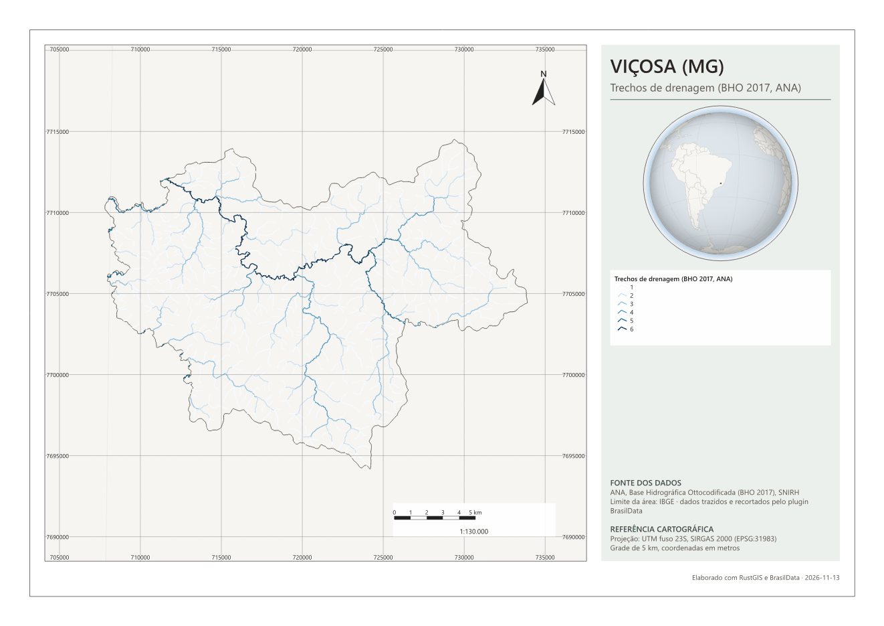

# Trechos de drenagem (BHO 2017, ANA)

<!-- Gerado por scripts/gerar.py a partir do fontes.csv e do fichas.csv; não edite à mão. -->

Os trechos de drenagem da Base Hidrográfica Ottocodificada da ANA, com a área a montante e a ordem de Strahler.

*Mapa exemplo: Viçosa (MG), feito com o plugin.*

| | |
|---|---|
| **Onde na aba** | Água › Hidrografia |
| **Fonte** | ANA |
| **Período** | BHO 2017 |
| **Resolução ou escala** | escala 1:50.000 onde há base nessa escala (1:250.000 no resto). |
| **Unidades** | área a montante em km² (nuareamont) |
| **Legenda** | Linhas com o código da ottobacia (cobacia), o nome do rio (noriocomp), o domínio (federal ou estadual, dedominial) e a ordem de Strahler (nustrahler). |
| **Cuidados de uso** | Rede gerada para gestão de recursos hídricos: alguns trechos são canais fictícios em lagos e represas. |
| **Licença** | reprodução permitida, desde que citada a fonte. |
| **Citação** | ANA, Base Hidrográfica Ottocodificada (BHO 2017), SNIRH. |
| **App desktop** | sim |
| **App web** | sim |

[Todas as camadas](README.md)
