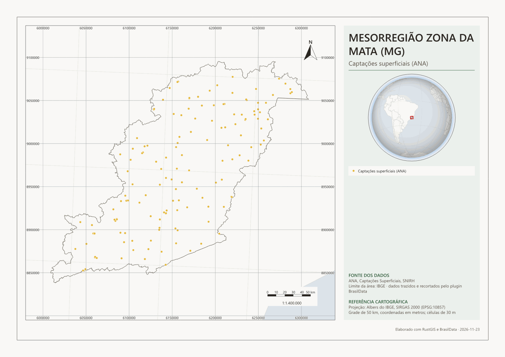

# Captações superficiais (ANA)

<!-- Gerado por scripts/gerar.py a partir do fontes.csv e do fichas.csv; não edite à mão. -->

As captações de água superficial para abastecimento público cadastradas pela ANA.

*Mapa exemplo: Zona da Mata (MG), feito com o plugin.*

| | |
|---|---|
| **Onde na aba** | Água › Recursos hídricos |
| **Fonte** | ANA |
| **Período** | base do SNIRH na data do pedido |
| **Resolução ou escala** | pontos |
| **Unidades** | sem unidade |
| **Legenda** | Pontos com o manancial, o tipo e o sistema de abastecimento, a UF e o município. |
| **Cuidados de uso** | Só as captações para abastecimento urbano do Atlas Águas; não inclui irrigação nem indústria. |
| **Licença** | dados abertos; licença não declarada no serviço. |
| **Citação** | ANA, Captações Superficiais, SNIRH |
| **App desktop** | sim |
| **App web** | não: só no app desktop (o servidor não aceita pedidos do navegador). |

[Todas as camadas](README.md)
