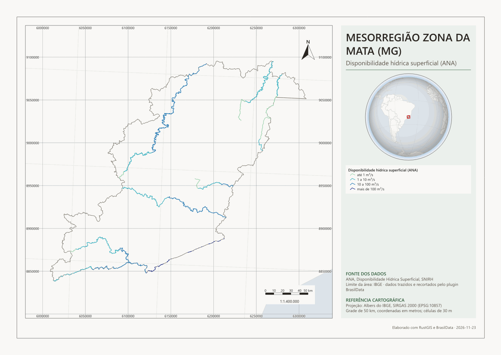

# Disponibilidade hídrica superficial (ANA)

<!-- Gerado por scripts/gerar.py a partir do fontes.csv e do fichas.csv; não edite à mão. -->

A disponibilidade hídrica superficial por trecho de rio: a vazão de referência que a ANA considera disponível.

*Mapa exemplo: Zona da Mata (MG), feito com o plugin.*

| | |
|---|---|
| **Onde na aba** | Água › Recursos hídricos |
| **Fonte** | ANA |
| **Período** | estudos da ANA (vazões de referência de séries históricas). |
| **Resolução ou escala** | trechos da BHO (1:250.000) |
| **Unidades** | vazão em m³/s |
| **Legenda** | Linhas por trecho, com as vazões de referência (Q95 e vazão disponível). |
| **Cuidados de uso** | Estimativa regional para planejamento; outorgas usam os critérios de cada órgão gestor. |
| **Licença** | dados abertos; licença não declarada no serviço. |
| **Citação** | ANA, Disponibilidade Hídrica Superficial, SNIRH. |
| **App desktop** | sim |
| **App web** | não: só no app desktop (o servidor não aceita pedidos do navegador). |

[Todas as camadas](README.md)
