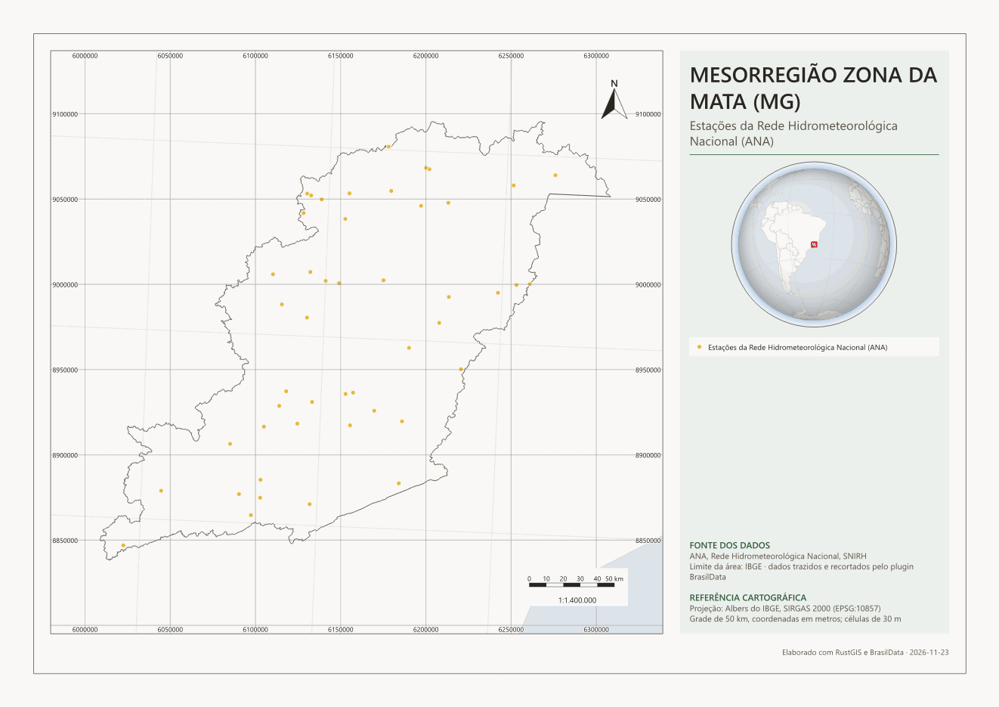

# Estações da Rede Hidrometeorológica Nacional (ANA)

<!-- Gerado por scripts/gerar.py a partir do fontes.csv e do fichas.csv; não edite à mão. -->

As estações da Rede Hidrometeorológica Nacional: pluviométricas, fluviométricas, de qualidade da água e de sedimentos.

*Mapa exemplo: Zona da Mata (MG), feito com o plugin.*

| | |
|---|---|
| **Onde na aba** | Água › Recursos hídricos |
| **Fonte** | ANA |
| **Período** | base do SNIRH na data do pedido |
| **Resolução ou escala** | pontos (coordenadas da estação) |
| **Unidades** | sem unidade; as séries ficam no HidroWeb |
| **Legenda** | Pontos com o código e o nome da estação (CODIGO, NOME_ESTAC). |
| **Cuidados de uso** | A camada mostra onde ficam as estações; as séries de chuva e vazão se baixam no HidroWeb pelo código. |
| **Licença** | dados abertos; licença não declarada no serviço. |
| **Citação** | ANA, Rede Hidrometeorológica Nacional, SNIRH. |
| **App desktop** | sim |
| **App web** | não: só no app desktop (o servidor não aceita pedidos do navegador). |

[Todas as camadas](README.md)
