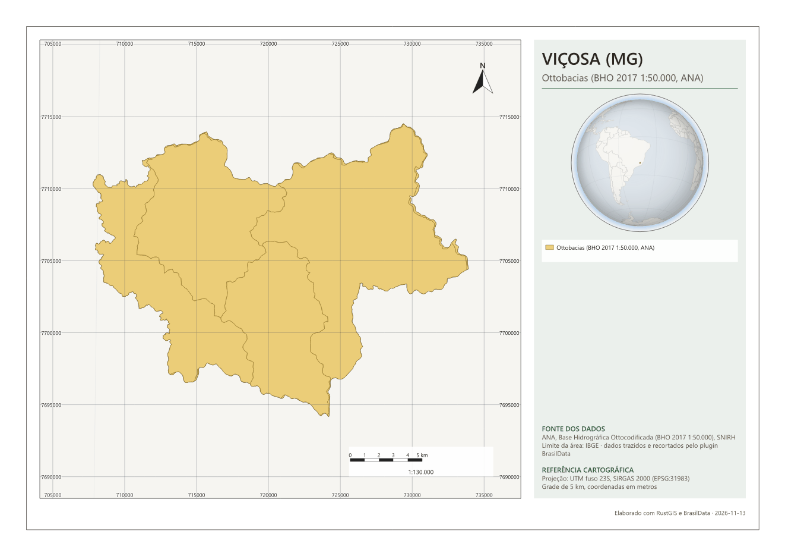

# Ottobacias (BHO 2017 1:50.000, ANA)

<!-- Gerado por scripts/gerar.py a partir do fontes.csv e do fichas.csv; não edite à mão. -->

As ottobacias da Base Hidrográfica Ottocodificada: cada bacia de contribuição de um trecho de rio, com o código de Otto Pfafstetter, que diz quem drena para quem.

*Mapa exemplo: Viçosa (MG), feito com o plugin.*

| | |
|---|---|
| **Onde na aba** | Água › Bacias |
| **Fonte** | ANA |
| **Período** | BHO 2017 |
| **Resolução ou escala** | escala 1:50.000 onde há base nessa escala (1:250.000 no resto). |
| **Unidades** | área de contribuição em km² (NUAREACONT) |
| **Legenda** | Polígonos com o código da ottobacia (COBACIA), do curso d'água (COCURSODAG), o nível (NUNIVOTTO) e a ordem (NUORDEMCDA). |
| **Cuidados de uso** | Ottobacias pequenas: para bacias maiores, junte pelo prefixo do código. A rede segue a hidrografia da época da base. |
| **Licença** | reprodução permitida, desde que citada a fonte. |
| **Citação** | ANA, Base Hidrográfica Ottocodificada (BHO 2017 1:50.000), SNIRH. |
| **App desktop** | sim |
| **App web** | sim |

[Todas as camadas](README.md)
