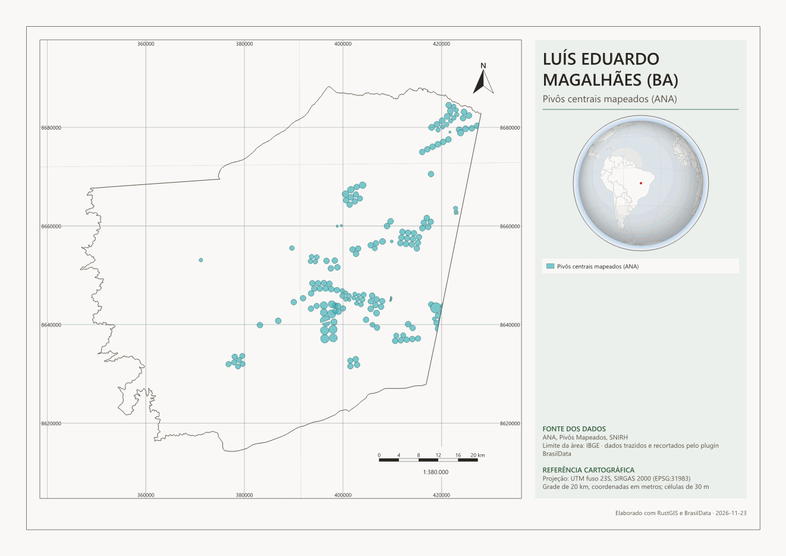

# Pivôs centrais mapeados (ANA)

<!-- Gerado por scripts/gerar.py a partir do fontes.csv e do fichas.csv; não edite à mão. -->

Os pivôs centrais de irrigação mapeados pela ANA e pela Embrapa em imagens de satélite.

*Mapa exemplo: Luís Eduardo Magalhães (BA), feito com o plugin.*

| | |
|---|---|
| **Onde na aba** | Água › Recursos hídricos |
| **Fonte** | ANA |
| **Período** | mapeamento mais recente publicado no SNIRH. |
| **Resolução ou escala** | polígonos dos círculos irrigados, mapeados em imagens de 10 a 30 m. |
| **Unidades** | área em ha |
| **Legenda** | Polígonos, um por pivô, com a área. |
| **Cuidados de uso** | Mapeamento de um ano: pivôs novos ou desativados podem estar faltando ou sobrando. |
| **Licença** | dados abertos; licença não declarada no serviço. |
| **Citação** | ANA, Pivôs Mapeados, SNIRH |
| **App desktop** | sim |
| **App web** | não: só no app desktop (o servidor não aceita pedidos do navegador). |

[Todas as camadas](README.md)
