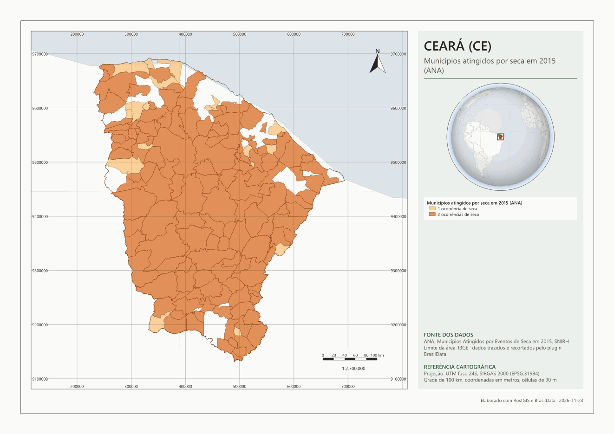

# Municípios atingidos por seca em 2015 (ANA)

<!-- Gerado por scripts/gerar.py a partir do fontes.csv e do fichas.csv; não edite à mão. -->

Os municípios em que a ANA registrou eventos de seca em 2015 (decretos e reconhecimentos).

*Mapa exemplo: Ceará, feito com o plugin.*

| | |
|---|---|
| **Onde na aba** | Água › Recursos hídricos |
| **Fonte** | ANA |
| **Período** | 2015 |
| **Resolução ou escala** | limites municipais (1:250.000) |
| **Unidades** | sem unidade |
| **Legenda** | Polígonos dos municípios atingidos. |
| **Cuidados de uso** | É o registro de um ano; não mede a intensidade da seca. |
| **Licença** | dados abertos; licença não declarada no serviço. |
| **Citação** | ANA, Municípios Atingidos por Eventos de Seca em 2015, SNIRH. |
| **App desktop** | sim |
| **App web** | não: só no app desktop (o servidor não aceita pedidos do navegador). |

[Todas as camadas](README.md)
