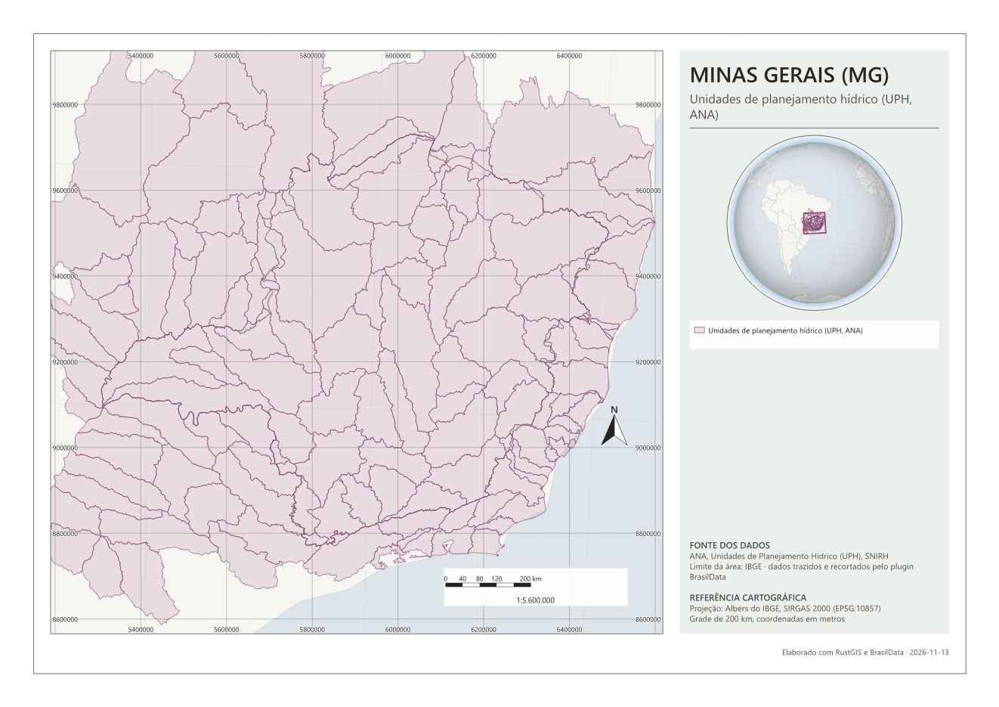

# Unidades de planejamento hídrico (UPH, ANA)

<!-- Gerado por scripts/gerar.py a partir do fontes.csv e do fichas.csv; não edite à mão. -->

As Unidades de Planejamento Hídrico da ANA, recortes de bacias usados nos planos e balanços hídricos.

*Mapa exemplo: Minas Gerais, feito com o plugin.*

| | |
|---|---|
| **Onde na aba** | Água › Bacias |
| **Fonte** | ANA |
| **Período** | versão do SNIRH vigente |
| **Resolução ou escala** | escala 1:1.000.000 |
| **Unidades** | sem unidade |
| **Legenda** | Polígonos com a sigla e o nome da UPH (UPH_SG, UPH_NM) e a região hidrográfica. |
| **Cuidados de uso** | Limites para mapas e estatística, não para demarcação legal. Vem o polígono inteiro de cada unidade que cruza a área, sem recorte. |
| **Licença** | reprodução permitida, desde que citada a fonte. |
| **Citação** | ANA, Unidades de Planejamento Hídrico (UPH), SNIRH. |
| **App desktop** | sim |
| **App web** | sim |

[Todas as camadas](README.md)
