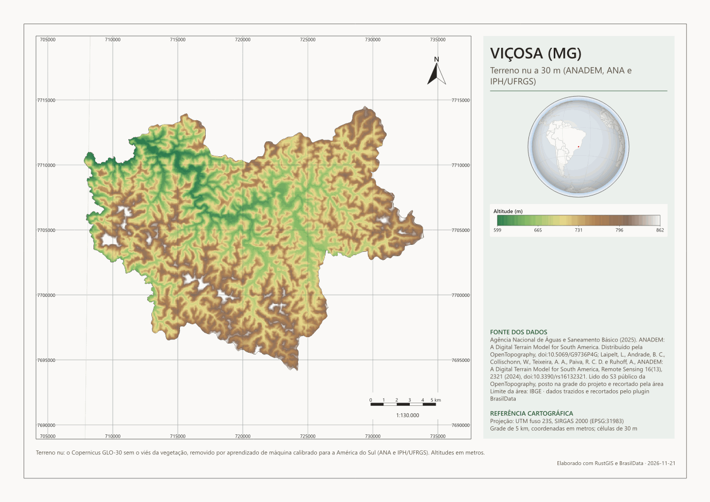

# Terreno da América do Sul a 30 m (ANADEM)

<!-- Gerado por scripts/gerar.py a partir do fontes.csv e do fichas.csv; não edite à mão. -->

O modelo digital do terreno da América do Sul a 30 m (ANADEM), da ANA e do IPH/UFRGS: o Copernicus GLO-30 sem o viés da vegetação, removido por aprendizado de máquina calibrado para o continente.

*Mapa exemplo: Viçosa (MG), feito com o plugin.*

| | |
|---|---|
| **Onde na aba** | Meio físico › Relevo |
| **Fonte** | ANA e IPH/UFRGS (pela OpenTopography) |
| **Período** | terreno do Copernicus GLO-30 (2011 a 2015), corrigido em 2024. |
| **Resolução ou escala** | 0,000269° (cerca de 30 m); numa área grande, a pirâmide do arquivo (60 m, 120 m...). |
| **Unidades** | metros (altitude), no SIRGAS 2000 |
| **Legenda** | Escala contínua nas cores do relevo, do mínimo ao máximo da área. |
| **Cuidados de uso** | Modelo, não levantamento: pode ter listras e emendas em áreas pequenas de mata densa ou relevo acidentado, que aparecem mais no sombreamento e nas derivadas sensíveis. Só a América do Sul. |
| **Licença** | livre e aberto, com a citação |
| **Citação** | Agência Nacional de Águas e Saneamento Básico (2025), ANADEM: A Digital Terrain Model for South America, distribuído pela OpenTopography, doi:10.5069/G9736P4G; Laipelt, L. et al., Remote Sensing 16(13), 2321 (2024), doi:10.3390/rs16132321. |
| **App desktop** | sim |
| **App web** | sim (o S3 da OpenTopography libera a leitura pelo navegador); precisa de um RustGIS depois da 0.5.0. |

[Todas as camadas](README.md)
