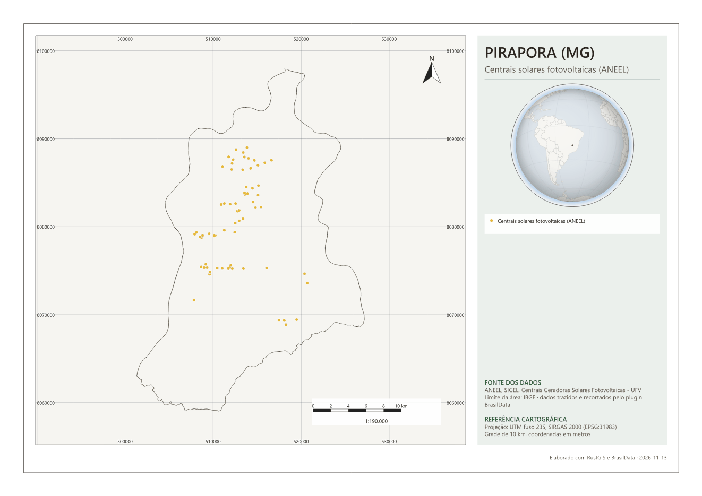

# Centrais solares fotovoltaicas (ANEEL)

<!-- Gerado por scripts/gerar.py a partir do fontes.csv e do fichas.csv; não edite à mão. -->

As usinas solares fotovoltaicas (UFV) de geração centralizada do Sistema de Informações Georreferenciadas do Setor Elétrico (SIGEL).

*Mapa exemplo: Pirapora (MG), feito com o plugin.*

| | |
|---|---|
| **Onde na aba** | Infraestrutura › Energia |
| **Fonte** | ANEEL |
| **Período** | base do SIGEL na data do pedido |
| **Resolução ou escala** | pontos |
| **Unidades** | potência em kW ou MW |
| **Legenda** | Pontos com o nome, a potência, a fase (operação, construção...) e o rio ou o combustível. |
| **Cuidados de uso** | Cadastro da ANEEL: a posição é a da usina ou do eixo da barragem informada pelo empreendedor. Inclui usinas em construção e outorgadas, conforme a fase. |
| **Licença** | dados abertos; licença não declarada no serviço. |
| **Citação** | ANEEL, SIGEL, Centrais Geradoras Solares Fotovoltaicas - UFV. |
| **App desktop** | sim |
| **App web** | não: só no app desktop (o servidor não aceita pedidos do navegador). |

[Todas as camadas](README.md)
