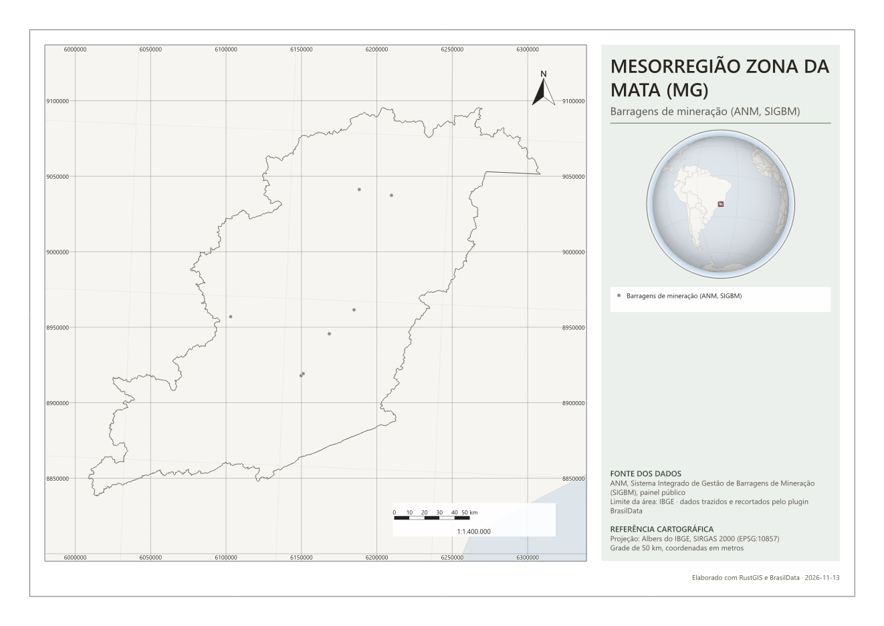

# Barragens de mineração (ANM, SIGBM)

<!-- Gerado por scripts/gerar.py a partir do fontes.csv e do fichas.csv; não edite à mão. -->

As barragens de mineração cadastradas no SIGBM, com a categoria de risco e o dano potencial associado.

*Mapa exemplo: Zona da Mata (MG), feito com o plugin.*

| | |
|---|---|
| **Onde na aba** | Meio físico › Geologia e recursos minerais. |
| **Fonte** | ANM |
| **Período** | painel público do SIGBM na data do pedido. |
| **Resolução ou escala** | pontos |
| **Unidades** | volume em m³ e altura em m, quando há |
| **Legenda** | Pontos com o nome, o minério, a categoria de risco e o dano potencial associado (baixo, médio, alto). |
| **Cuidados de uso** | Classificação declarada pelo empreendedor e fiscalizada pela ANM; para a mancha de inundação, o Plano de Ação de Emergência. |
| **Licença** | dados abertos, com crédito à ANM |
| **Citação** | ANM, Sistema Integrado de Gestão de Barragens de Mineração (SIGBM), painel público. |
| **App desktop** | sim |
| **App web** | sim |

[Todas as camadas](README.md)
