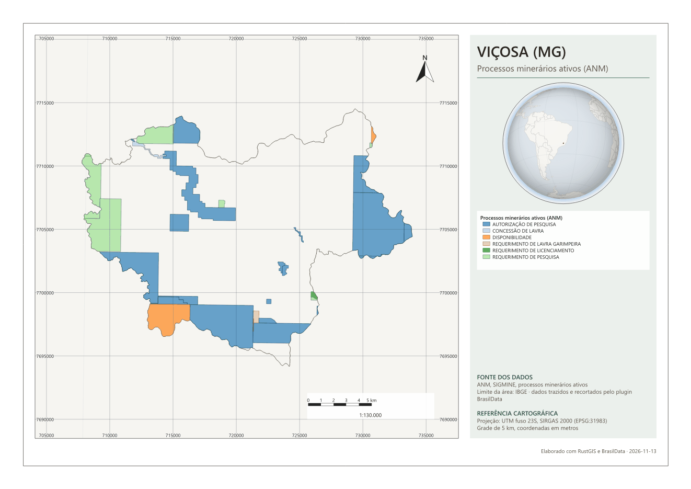

# Processos minerários ativos (ANM)

<!-- Gerado por scripts/gerar.py a partir do fontes.csv e do fichas.csv; não edite à mão. -->

Os processos minerários ativos do SIGMINE: as áreas requeridas ou tituladas para pesquisa, lavra e licenciamento.

*Mapa exemplo: Viçosa (MG), feito com o plugin.*

| | |
|---|---|
| **Onde na aba** | Meio físico › Geologia e recursos minerais. |
| **Fonte** | ANM |
| **Período** | base do SIGMINE na data do pedido |
| **Resolução ou escala** | polígonos do memorial descritivo |
| **Unidades** | área em ha (AREA_HA) |
| **Legenda** | Polígonos pela fase (requerimento de pesquisa, autorização de pesquisa, concessão de lavra, licenciamento...), com a substância, o uso e o ano. |
| **Cuidados de uso** | Cadastro administrativo da ANM: um processo é um pedido ou um título, não uma mina em operação. |
| **Licença** | dados abertos, com crédito à ANM |
| **Citação** | ANM, SIGMINE, processos minerários ativos. |
| **App desktop** | sim |
| **App web** | sim |

[Todas as camadas](README.md)
