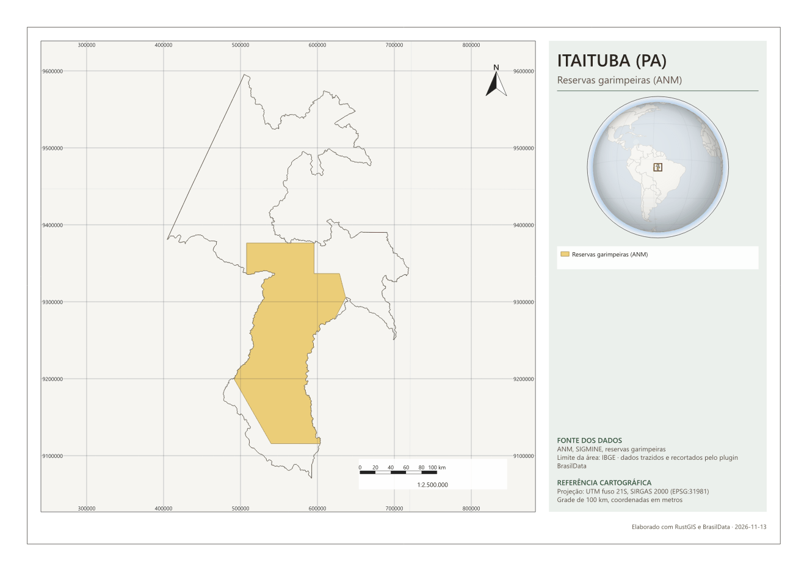

# Reservas garimpeiras (ANM)

<!-- Gerado por scripts/gerar.py a partir do fontes.csv e do fichas.csv; não edite à mão. -->

As reservas garimpeiras da ANM.

*Mapa exemplo: Itaituba (PA), feito com o plugin.*

| | |
|---|---|
| **Onde na aba** | Meio físico › Geologia e recursos minerais. |
| **Fonte** | ANM |
| **Período** | base do SIGMINE na data do pedido |
| **Resolução ou escala** | polígonos |
| **Unidades** | área em ha |
| **Legenda** | Polígonos com o nome da reserva. |
| **Cuidados de uso** | Cadastro administrativo da ANM: um processo é um pedido ou um título, não uma mina em operação. |
| **Licença** | dados abertos, com crédito à ANM |
| **Citação** | ANM, SIGMINE, reservas garimpeiras |
| **App desktop** | sim |
| **App web** | sim |

[Todas as camadas](README.md)
