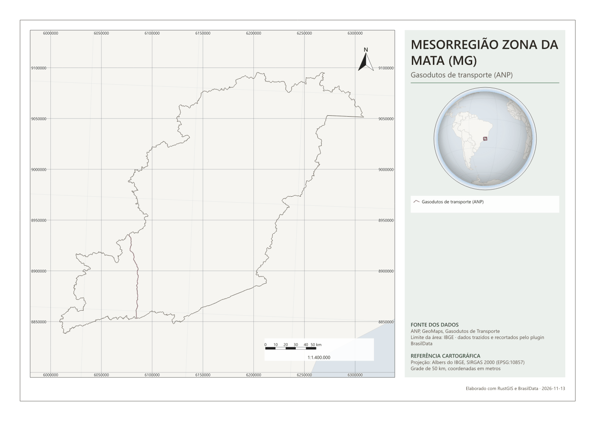

# Gasodutos de transporte (ANP)

<!-- Gerado por scripts/gerar.py a partir do fontes.csv e do fichas.csv; não edite à mão. -->

Os gasodutos de transporte de gás natural.

*Mapa exemplo: Zona da Mata (MG), feito com o plugin.*

| | |
|---|---|
| **Onde na aba** | Infraestrutura › Petróleo e gás |
| **Fonte** | ANP |
| **Período** | base do GeoMaps da ANP na data do pedido |
| **Resolução ou escala** | traçado em escala regional |
| **Unidades** | diâmetro em polegadas e extensão em km, quando há. |
| **Legenda** | Linhas com o nome do duto e o operador. |
| **Cuidados de uso** | Traçado aproximado; não serve para localizar o duto no terreno (ligue para o operador antes de escavar). |
| **Licença** | dados abertos; licença não declarada no serviço. |
| **Citação** | ANP, GeoMaps, Gasodutos de Transporte |
| **App desktop** | sim |
| **App web** | não: só no app desktop (o servidor não aceita pedidos do navegador). |

[Todas as camadas](README.md)
