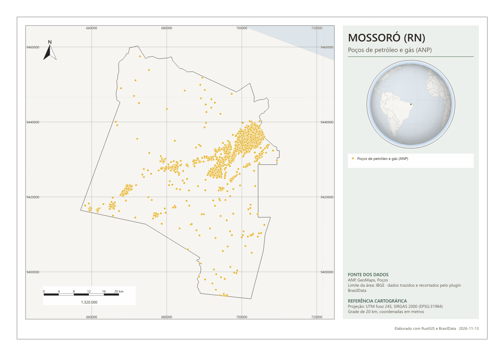

# Poços de petróleo e gás (ANP)

<!-- Gerado por scripts/gerar.py a partir do fontes.csv e do fichas.csv; não edite à mão. -->

Os poços de petróleo e gás perfurados (exploratórios e de produção).

*Mapa exemplo: Mossoró (RN), feito com o plugin.*

| | |
|---|---|
| **Onde na aba** | Infraestrutura › Petróleo e gás |
| **Fonte** | ANP |
| **Período** | base do GeoMaps da ANP na data do pedido |
| **Resolução ou escala** | pontos (cabeça do poço) |
| **Unidades** | profundidade em m, quando há |
| **Legenda** | Pontos com o nome do poço, a categoria, o resultado e o operador. |
| **Cuidados de uso** | Base da ANP para a exploração e a produção de petróleo e gás; os limites de blocos e campos mudam a cada rodada de licitação. |
| **Licença** | dados abertos; licença não declarada no serviço. |
| **Citação** | ANP, GeoMaps, Poços |
| **App desktop** | sim |
| **App web** | não: só no app desktop (o servidor não aceita pedidos do navegador). |

[Todas as camadas](README.md)
