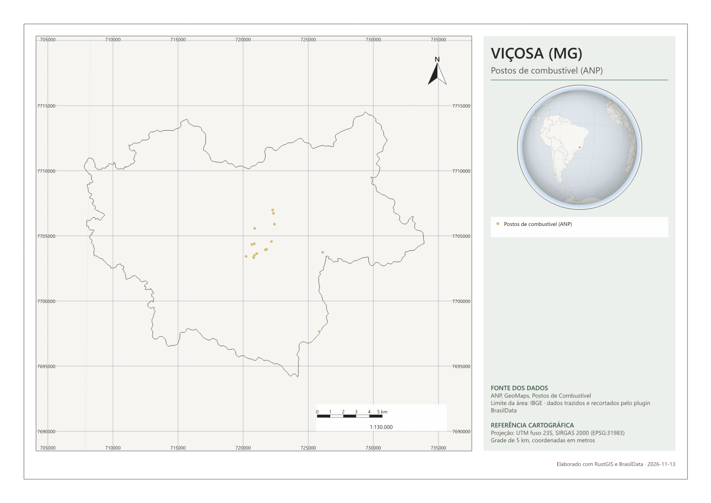

# Postos de combustível (ANP)

<!-- Gerado por scripts/gerar.py a partir do fontes.csv e do fichas.csv; não edite à mão. -->

Os postos revendedores de combustível autorizados pela ANP.

*Mapa exemplo: Viçosa (MG), feito com o plugin.*

| | |
|---|---|
| **Onde na aba** | Infraestrutura › Petróleo e gás |
| **Fonte** | ANP |
| **Período** | cadastro da ANP na data do pedido |
| **Resolução ou escala** | pontos (coordenada do endereço) |
| **Unidades** | sem unidade |
| **Legenda** | Pontos com o nome, a bandeira, o endereço e a situação. |
| **Cuidados de uso** | Coordenadas geocodificadas pelo endereço: alguns postos ficam deslocados. |
| **Licença** | dados abertos; licença não declarada no serviço. |
| **Citação** | ANP, GeoMaps, Postos de Combustível |
| **App desktop** | sim |
| **App web** | não: só no app desktop (o servidor não aceita pedidos do navegador). |

[Todas as camadas](README.md)
