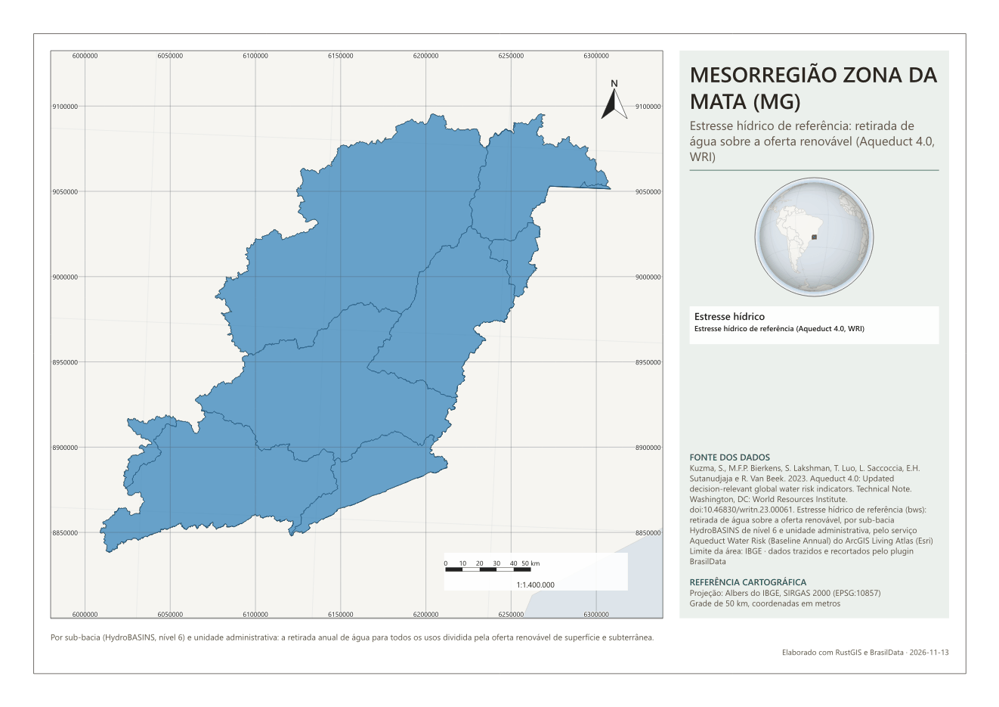

# Estresse hídrico de referência (Aqueduct 4.0, WRI)

<!-- Gerado por scripts/gerar.py a partir do fontes.csv e do fichas.csv; não edite à mão. -->

O estresse hídrico de referência do Aqueduct 4.0 (WRI): a retirada de água sobre a oferta renovável, por sub-bacia.

*Mapa exemplo: Zona da Mata (MG), feito com o plugin.*

| | |
|---|---|
| **Onde na aba** | Água › Recursos hídricos |
| **Fonte** | Kuzma |
| **Período** | condição de referência (1979 a 2019) |
| **Resolução ou escala** | sub-bacias HydroBASINS de nível 6 (centenas a milhares de km²). |
| **Unidades** | razão retirada/oferta (bws_raw); nota de 0 a 5 (bws_score). |
| **Legenda** | Polígonos pela categoria (estresse): baixo (<10%), baixo a médio (10 a 20%), médio a alto (20 a 40%), alto (40 a 80%), extremamente alto (>80%); árido e de pouco uso; sem dado. |
| **Cuidados de uso** | Modelo global (PCR-GLOBWB 2): bom para comparar regiões, não para a gestão de uma bacia pequena. |
| **Licença** | CC BY 4.0 (WRI) |
| **Citação** | Kuzma, S., M.F.P. Bierkens, S. Lakshman, T. Luo, L. Saccoccia, E.H. Sutanudjaja e R. Van Beek. 2023. Aqueduct 4.0: Updated decision-relevant global water risk indicators. Technical Note. Washington, DC: World Resources Institute. doi:10.46830/writn.23.00061. Estresse hídrico de referência (bws): retirada de água sobre a oferta renovável, por sub-bacia HydroBASINS de nível 6 e unidade administrativa, pelo serviço Aqueduct Water Risk (Baseline Annual) do ArcGIS Living Atlas (Esri). Campos: bws_raw, a razão; bws_score, de 0 a 5; bws_cat, a categoria (-1 árido e de pouco uso, -9999 sem dado); estresse, a categoria em português. |
| **App desktop** | sim |
| **App web** | sim |

[Todas as camadas](README.md)
