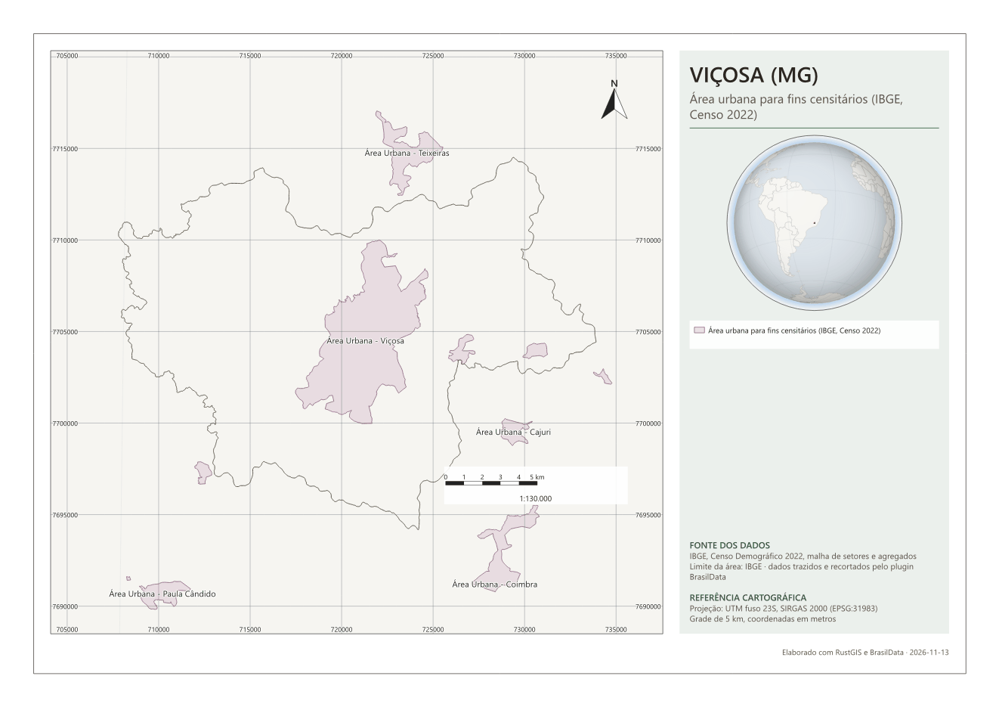

# Área urbana para fins censitários (IBGE, Censo 2022)

<!-- Gerado por scripts/gerar.py a partir do fontes.csv e do fichas.csv; não edite à mão. -->

A área urbana de cada município para fins censitários (a soma dos setores urbanos).

*Mapa exemplo: Viçosa (MG), feito com o plugin.*

| | |
|---|---|
| **Onde na aba** | Sociedade e economia › População |
| **Fonte** | IBGE |
| **Período** | malha do Censo Demográfico 2022 |
| **Resolução ou escala** | escala cadastral dos setores censitários |
| **Unidades** | área em km² |
| **Legenda** | Um polígono por município. |
| **Cuidados de uso** | Definida pela lei municipal de perímetro urbano, que pode incluir áreas ainda não urbanizadas. |
| **Licença** | uso livre com citação da fonte |
| **Citação** | IBGE, Censo Demográfico 2022, malha de setores e agregados. |
| **App desktop** | sim |
| **App web** | sim |

[Todas as camadas](README.md)
