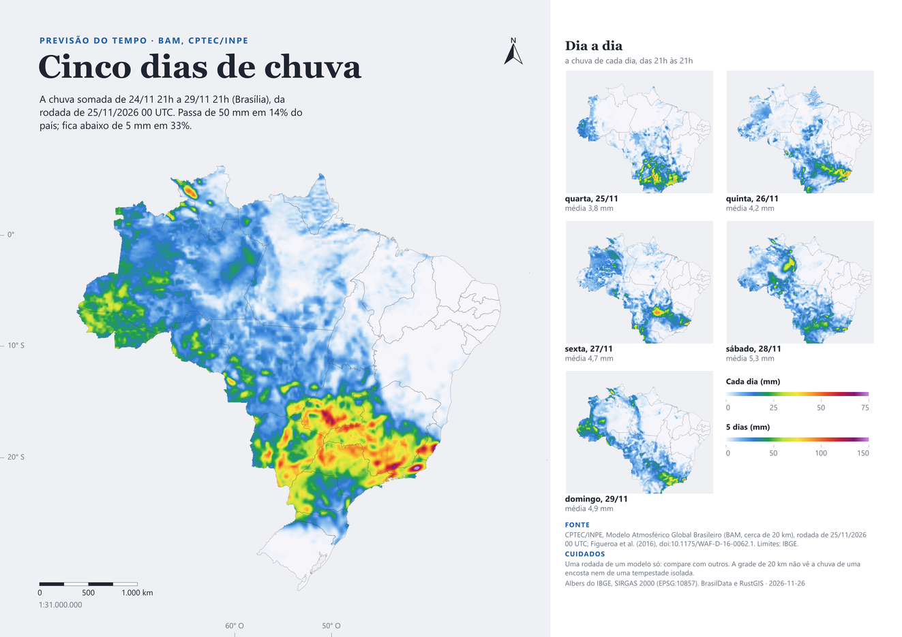

# Previsão do BAM (CPTEC/INPE)

<!-- Gerado por scripts/gerar.py a partir do fontes.csv e do fichas.csv; não edite à mão. -->

A chuva somada ou a temperatura média prevista nos próximos dias pelo BAM, o modelo global de previsão do tempo do CPTEC/INPE.

*Mapa exemplo: Brasil, com o dado do plugin e a folha feita à parte no RustGIS.*

| | |
|---|---|
| **Onde na aba** | Tempo e clima › Previsão |
| **Fonte** | CPTEC/INPE (Centro de Previsão de Tempo e Estudos Climáticos). |
| **Período** | de 1 a 10 dias a partir das 00 UTC (21h de Brasília) da rodada mais recente, ou de uma rodada passada (o servidor guarda desde 2025). |
| **Resolução ou escala** | cerca de 20 km (0,18°, TQ0666), interpolada para a grade do projeto. |
| **Unidades** | mm (chuva somada) ou °C (temperatura média). |
| **Legenda** | A chuva, do branco ao azul, verde, amarelo, vermelho e roxo, nas mesmas cores e escalas da Chuva prevista; a temperatura, de 0 °C (azul-escuro) a 40 °C (vermelho-escuro). |
| **Cuidados de uso** | É uma rodada de um modelo só: compare com a Chuva prevista do ECMWF e com o ensemble. A grade de 20 km não vê a chuva de uma encosta nem de uma tempestade isolada. A temperatura é a média de quatro horários (03h, 09h, 15h e 21h), não a média das máximas e mínimas. Cada dia baixa quatro registros de cerca de 4 MB do servidor do CPTEC. |
| **Licença** | dados públicos do INPE, com a citação da fonte. |
| **Citação** | CPTEC/INPE, Modelo Atmosférico Global Brasileiro (BAM), TQ0666L064; Figueroa, S. N. et al. (2016), Weather and Forecasting 31, 1547–1572, doi:10.1175/WAF-D-16-0062.1. |
| **App desktop** | sim |
| **App web** | não (o app web ainda não baixa um trecho de arquivo de outro site). |

[Todas as camadas](README.md)
