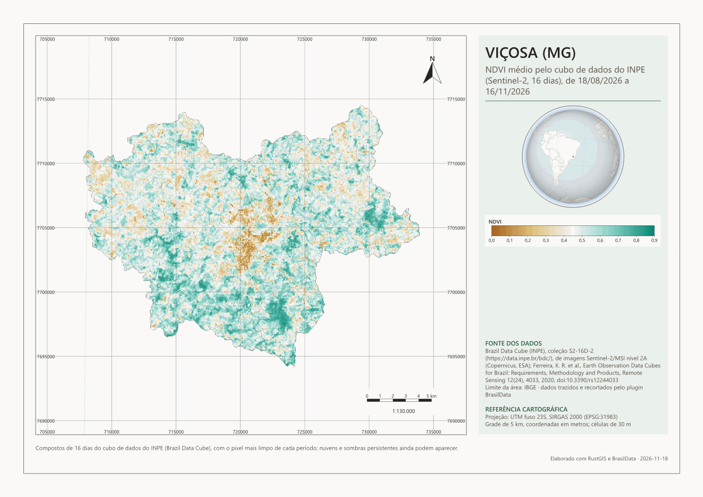

# Índice de vegetação (cubo do INPE)

<!-- Gerado por scripts/gerar.py a partir do fontes.csv e do fichas.csv; não edite à mão. -->

O NDVI ou o EVI do cubo de dados do INPE (Brazil Data Cube), resumido num período: a média, a máxima, a mínima ou o desvio das datas de 16 dias.

*Mapa exemplo: Viçosa (MG), feito com o plugin.*

| | |
|---|---|
| **Onde na aba** | Vegetação e meio ambiente › Cubo de dados do INPE. |
| **Fonte** | INPE (Brazil Data Cube) |
| **Período** | Sentinel-2 desde 2017, Landsat desde 1990, CBERS-4 desde 2016, MODIS desde 2000, até a data mais recente. |
| **Resolução ou escala** | 10 m (Sentinel-2), 30 m (Landsat), 64 m (CBERS-4 WFI) ou 232 m (MODIS). |
| **Unidades** | índice, de -1 a 1 (a vegetação vai de 0,2 a 0,9). |
| **Legenda** | Escala contínua do marrom (solo exposto) ao verde (vegetação densa), de 0 a 0,9 no NDVI e de 0 a 0,8 no EVI. |
| **Cuidados de uso** | Os compostos de 16 dias guardam o pixel mais limpo, mas nuvens e sombras persistentes ainda aparecem; um período curto na estação chuvosa pode ter falhas. O desvio-padrão mede a variação, não o verde. |
| **Licença** | Sentinel-2: dados Copernicus, livres com atribuição; Landsat: domínio público (USGS); CBERS-4: CC BY 4.0 (INPE); MODIS: sem restrição de uso (NASA LP DAAC). |
| **Citação** | Brazil Data Cube (INPE), cubos de 16 dias S2-16D-2, LANDSAT-16D-1, CBERS4-WFI-16D-2 e MOD13Q1 v6.1; Ferreira et al. 2020, Earth Observation Data Cubes for Brazil, Remote Sensing 12(24), 4033, doi:10.3390/rs12244033. |
| **App desktop** | sim |
| **App web** | não: só no desktop (o resumo do cubo, cube.reduce, lê o STAC no desktop). |

[Todas as camadas](README.md)
