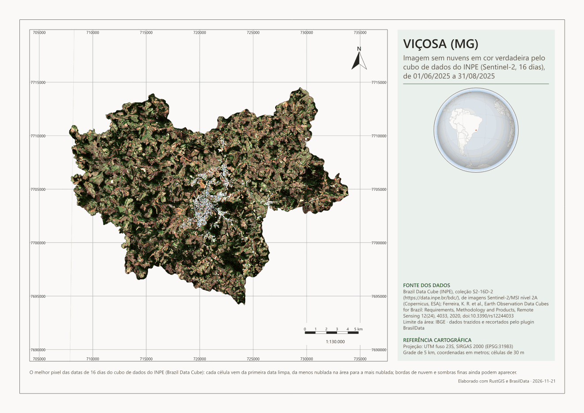

# Imagem sem nuvens (cubo do INPE)

<!-- Gerado por scripts/gerar.py a partir do fontes.csv e do fichas.csv; não edite à mão. -->

Uma imagem de satélite sem nuvens da área, em cor verdadeira ou em falsa-cor: o melhor pixel das datas de 16 dias de um período, com a data de origem de cada célula.

*Mapa exemplo: Viçosa (MG), feito com o plugin.*

| | |
|---|---|
| **Onde na aba** | Vegetação e meio ambiente › Cubo de dados do INPE. |
| **Fonte** | INPE (Brazil Data Cube) |
| **Período** | Sentinel-2 desde 2017, Landsat desde 1990, CBERS-4 desde 2016, até a data mais recente; períodos de 16 dias a 1 ano. |
| **Resolução ou escala** | 10 m (Sentinel-2), 30 m (Landsat) ou 64 m (CBERS-4 WFI), na resolução do satélite, no sistema da grade do projeto (não nas células dela); áreas grandes, com células maiores. |
| **Unidades** | reflectância de superfície, de 0 a 1, em três bandas. |
| **Legenda** | Cor verdadeira: vermelho, verde e azul com um contraste fixo por satélite, o mesmo em todas as áreas e datas (no Sentinel-2, 0,01–0,16, 0,02–0,13 e 0,01–0,10 de reflectância). Falsa-cor: infravermelho próximo (0,05–0,45), vermelho e verde; a vegetação viva sai vermelha. A data de origem tem uma cor por data, da menos nublada para a mais nublada. |
| **Cuidados de uso** | A máscara de nuvem dos compostos deixa passar bordas de nuvem, sombras finas e neblina, mesmo crescida de 1 ou 2 células; onde nenhuma data foi limpa, a célula fica vazia (transparente). Datas de estações diferentes no mesmo período dão emendas de cor (a lavoura colhida ao lado da verde). O contraste é fixo: áreas muito claras (areia, cidade) saturam. |
| **Licença** | Sentinel-2: dados Copernicus, livres com atribuição; Landsat: domínio público (USGS); CBERS-4: CC BY 4.0 (INPE). |
| **Citação** | Brazil Data Cube (INPE), cubos de 16 dias S2-16D-2, LANDSAT-16D-1 e CBERS4-WFI-16D-2; Ferreira et al. 2020, Earth Observation Data Cubes for Brazil, Remote Sensing 12(24), 4033, doi:10.3390/rs12244033. |
| **App desktop** | sim |
| **App web** | não: só no desktop (o cube.reduce lê o STAC no desktop, e a montagem usa ferramentas do GeoLibre). |

[Todas as camadas](README.md)
