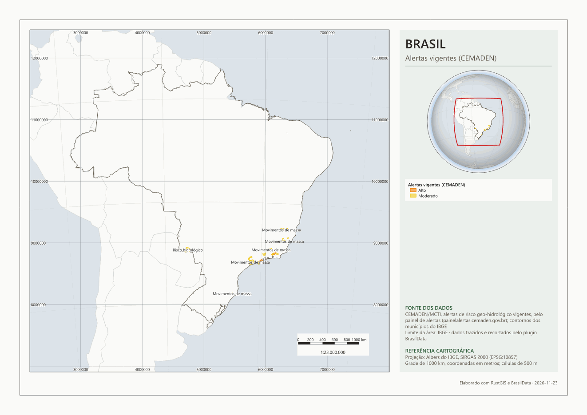

# Alertas vigentes (CEMADEN)

<!-- Gerado por scripts/gerar.py a partir do fontes.csv e do fichas.csv; não edite à mão. -->

Os alertas de risco geo-hidrológico vigentes que o CEMADEN emite para a Defesa Civil: risco hidrológico (enxurradas, inundações) e movimentos de massa (deslizamentos), por município.

*Mapa exemplo: Brasil, feito com o plugin.*

| | |
|---|---|
| **Onde na aba** | Tempo e clima › Desastres |
| **Fonte** | CEMADEN (MCTI) |
| **Período** | agora: os alertas em vigor no momento do clique. |
| **Resolução ou escala** | município (o contorno da malha intermediária do IBGE que vem no plugin). |
| **Unidades** | sem unidade; emitido e atualizado no horário de Brasília (aaaa-mm-dd hh:mm). |
| **Legenda** | Municípios na cor do nível: moderado (amarelo), alto (laranja) e muito alto (vermelho), com o evento como rótulo. Campos: município, UF, código do IBGE, evento, nível, emitido e atualizado. |
| **Cuidados de uso** | O alerta é para o município, não para um lugar dele: as áreas de risco mapeadas dentro dele é que estão sob ameaça. Os níveis seguem o protocolo do CEMADEN com a Defesa Civil. Para decidir, siga a Defesa Civil local; o painel do CEMADEN (painelalertas.cemaden.gov.br) tem o texto de cada alerta. |
| **Licença** | licença não declarada para os dados; citar a fonte (o conteúdo do portal do CEMADEN é CC BY-ND 3.0). |
| **Citação** | CEMADEN/MCTI, alertas de risco geo-hidrológico vigentes, pelo painel de alertas (painelalertas.cemaden.gov.br); contornos dos municípios do IBGE. |
| **App desktop** | sim |
| **App web** | não: o servidor não aceita pedidos do app web. |

[Todas as camadas](README.md)
