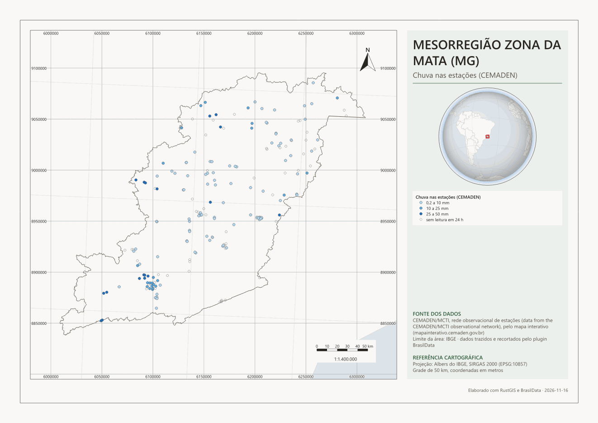

# Chuva nas estações (CEMADEN)

<!-- Gerado por scripts/gerar.py a partir do fontes.csv e do fichas.csv; não edite à mão. -->

A chuva medida nas estações automáticas do CEMADEN: os acumulados das últimas horas em cada pluviômetro e nas estações hidrológicas, geotécnicas e agrometeorológicas.

*Mapa exemplo: Zona da Mata (MG), feito com o plugin.*

| | |
|---|---|
| **Onde na aba** | Tempo e clima › Chuva observada |
| **Fonte** | CEMADEN (MCTI) |
| **Período** | agora: os acumulados de 1, 3, 6, 12, 24, 48, 72 e 96 horas até a última leitura, atualizados a cada 10 minutos. |
| **Resolução ou escala** | pontos (a posição de cada estação); leituras a cada 10 minutos com chuva e a cada hora sem. |
| **Unidades** | mm (chuva_10min, chuva_1h a chuva_96h); leitura_utc em UTC (aaaa-mm-dd hh:mm). |
| **Legenda** | Círculos pela chuva em 24 horas (faixa_24h): 0 mm, 0,2 a 10 mm, 10 a 25, 25 a 50, 50 a 100 e mais de 100 mm; vazio e cinza, sem leitura nas últimas 24 horas. Campos: código, nome, tipo, município, UF, código do IBGE, hora da última leitura e os acumulados. |
| **Cuidados de uso** | Dado bruto, sem consistência: um pluviômetro entupido marca zero, e um defeito pode dar valores absurdos. Um campo vazio é intervalo sem leitura (estação fora do ar). As coordenadas vêm da lista das estações que vem no plugin: uma estação nova fica de fora até a versão seguinte. Para séries históricas, use a PED do CEMADEN (cadastro gratuito). |
| **Licença** | licença não declarada para os dados; citar a fonte (o conteúdo do portal do CEMADEN é CC BY-ND 3.0). |
| **Citação** | CEMADEN/MCTI, rede observacional de estações (data from the CEMADEN/MCTI observational network), pelo mapa interativo (mapainterativo.cemaden.gov.br). |
| **App desktop** | sim |
| **App web** | não: o servidor não aceita pedidos do app web. |

[Todas as camadas](README.md)
