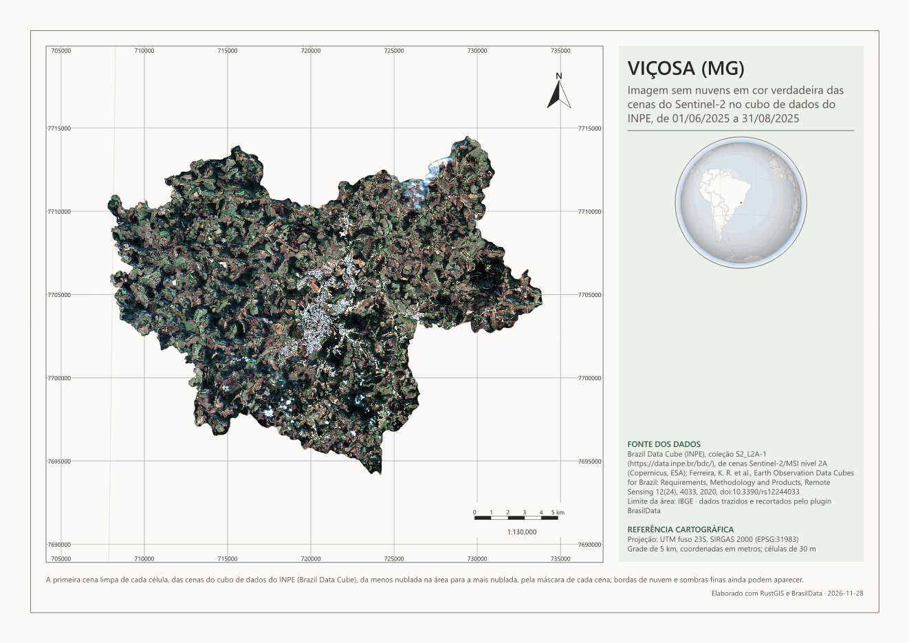

# Imagem sem nuvens das cenas (Sentinel-2 e Landsat)

<!-- Gerado por scripts/gerar.py a partir do fontes.csv e do fichas.csv; não edite à mão. -->

Uma imagem de satélite sem nuvens da área, em cor verdadeira ou em falsa-cor, montada das cenas do Sentinel-2 L2A ou do Landsat Coleção 2 nível 2 do INPE: cada célula vem da primeira cena limpa do período.

*Mapa exemplo: Viçosa (MG), feito com o plugin.*

| | |
|---|---|
| **Onde na aba** | Vegetação e meio ambiente › Cubo de dados do INPE. |
| **Fonte** | INPE (Brazil Data Cube); ESA e USGS |
| **Período** | Sentinel-2 desde 2018, Landsat desde 1985, até a cena mais recente; até 4 meses por imagem. |
| **Resolução ou escala** | 10 m (Sentinel-2) ou 30 m (Landsat) |
| **Unidades** | reflectância de superfície, de 0 a 1 |
| **Legenda** | Cor verdadeira: vermelho, verde e azul com o mesmo contraste fixo da imagem do cubo (0,01–0,16, 0,02–0,13 e 0,01–0,10 de reflectância). Falsa-cor: infravermelho próximo (0,05–0,45), vermelho e verde; a vegetação viva sai vermelha. |
| **Cuidados de uso** | A nuvem vem só da máscara de cada cena, sem crescer as bordas: as beiradas de nuvem podem escapar (a imagem do cubo as cresce). Num RustGIS depois da 0.8.0, com o firstDate do cube.reduce, vem junto a camada da data de origem, que diz de que cena veio cada célula. Cenas de datas diferentes se juntam: num período longo, as estações se misturam. O Landsat 7 tem faixas sem dado desde 2003, que as outras cenas preenchem. No Sentinel-2, o período não pode cruzar 25/01/2022, quando o processamento mudou a escala. É lenta: cada banda lê todas as cenas do período (uns 5 minutos para 3 meses num município do tamanho de Viçosa); o STAC do INPE não filtra as cenas pela nuvem. |
| **Licença** | Copernicus (Sentinel) e domínio público do USGS (Landsat). |
| **Citação** | Brazil Data Cube (INPE), coleções S2_L2A-1 e landsat-2, de cenas Sentinel-2/MSI nível 2A (Copernicus, ESA) e Landsat Coleção 2 nível 2 (USGS); Ferreira, K. R. et al., Remote Sensing 12(24), 4033, 2020, doi:10.3390/rs12244033. |
| **App desktop** | sim |
| **App web** | não: a junção das bandas usa a Composite Bands do GeoLibre, que o app web não tem. |

[Todas as camadas](README.md)
