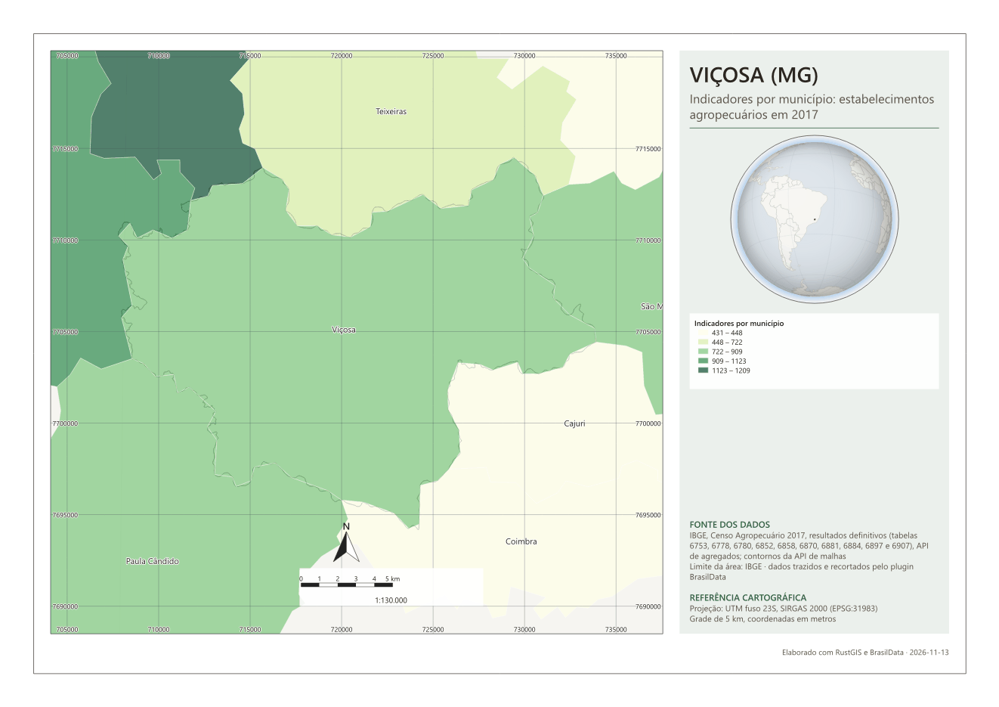

# Censo Agropecuário 2017 (IBGE)

<!-- Gerado por scripts/gerar.py a partir do fontes.csv e do fichas.csv; não edite à mão. -->

O Censo Agropecuário 2017 por município: estabelecimentos, agricultura familiar, utilização das terras, rebanho, pessoal, máquinas, irrigação, agrotóxicos, energia, assistência técnica e valor da produção.

*Mapa exemplo: Viçosa (MG), feito com o plugin.*

| | |
|---|---|
| **Onde na aba** | Sociedade e economia › Agricultura |
| **Fonte** | IBGE (SIDRA) |
| **Período** | 2017 (período de referência de 01/10/2016 a 30/09/2017). |
| **Resolução ou escala** | município |
| **Unidades** | número de estabelecimentos; ha; cabeças; pessoas; mil R$. |
| **Legenda** | Na camada Indicadores por município, os municípios que cruzam a área (até 200, mostrados só dentro dela); o layout faz um mapa coroplético. A tabela Fontes diz o que é cada campo. |
| **Cuidados de uso** | Dados declarados pelos produtores; o IBGE omite (X) valores que identificariam um estabelecimento, e eles vêm vazios. |
| **Licença** | uso livre com citação da fonte |
| **Citação** | IBGE, Censo Agropecuário 2017, resultados definitivos, API de agregados; contornos da Malha Municipal 2025 (WFS do IBGE). |
| **App desktop** | sim |
| **App web** | sim |

[Todas as camadas](README.md)
