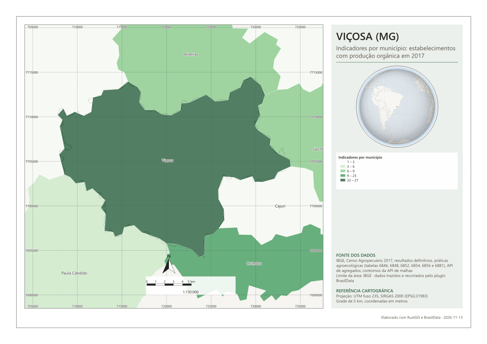

# Agroecologia (Censo Agropecuário 2017)

<!-- Gerado por scripts/gerar.py a partir do fontes.csv e do fichas.csv; não edite à mão. -->

Práticas agroecológicas do Censo Agropecuário 2017 por município: produção orgânica, associativismo, práticas de conservação, plantio direto, adubação, uso de agrotóxicos e sistemas agroflorestais.

*Mapa exemplo: Viçosa (MG), feito com o plugin.*

| | |
|---|---|
| **Onde na aba** | Sociedade e economia › Agricultura |
| **Fonte** | IBGE (SIDRA) |
| **Período** | 2017 |
| **Resolução ou escala** | município |
| **Unidades** | número de estabelecimentos; ha (plantio direto, SAFs). |
| **Legenda** | Na camada Indicadores por município, os municípios que cruzam a área (até 50); o layout faz um mapa coroplético. A tabela Fontes diz o que é cada campo. |
| **Cuidados de uso** | Um estabelecimento pode adotar várias práticas: os números não se somam. |
| **Licença** | uso livre com citação da fonte |
| **Citação** | IBGE, Censo Agropecuário 2017, resultados definitivos, práticas agroecológicas, API de agregados; contornos da API de malhas. |
| **App desktop** | sim |
| **App web** | sim |

[Todas as camadas](README.md)
