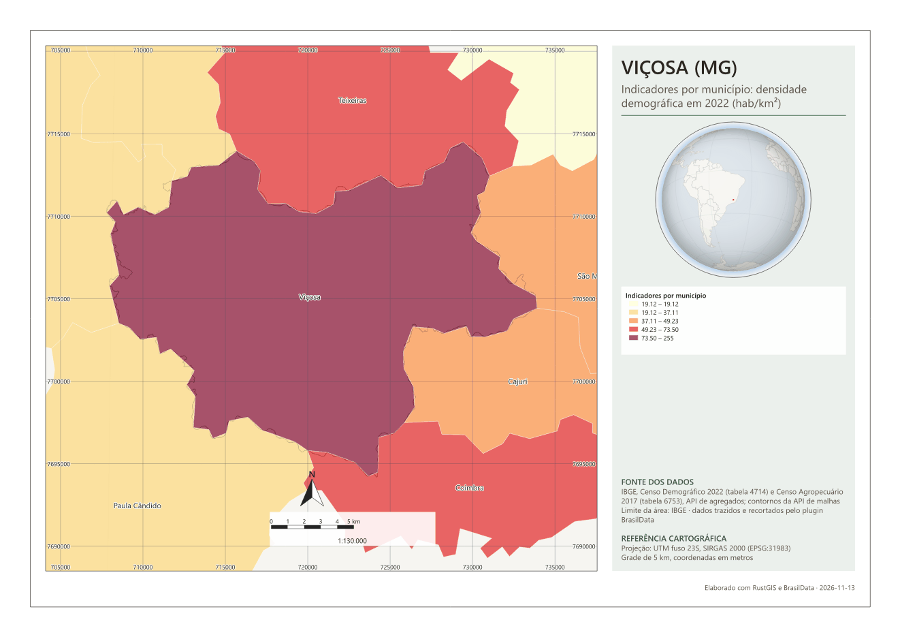

# Censos por município (IBGE)

<!-- Gerado por scripts/gerar.py a partir do fontes.csv e do fichas.csv; não edite à mão. -->

População, área e densidade de 2022 (Censo Demográfico) e estabelecimentos agropecuários e agricultura familiar de 2017 (Censo Agropecuário), por município.

*Mapa exemplo: Viçosa (MG), feito com o plugin.*

| | |
|---|---|
| **Onde na aba** | Sociedade e economia › População |
| **Fonte** | IBGE (SIDRA) |
| **Período** | 2022 (população) e 2017 (estabelecimentos). |
| **Resolução ou escala** | município |
| **Unidades** | habitantes; km²; habitantes por km²; número de estabelecimentos; ha. |
| **Legenda** | Na camada Indicadores por município, os municípios que cruzam a área (até 50); o layout faz um mapa coroplético. Campos: pop_2022, area_km2, dens_2022, estab_2017, estab_fam, area_agro_ha, area_fam_ha. |
| **Cuidados de uso** | Médias municipais escondem a diferença entre a cidade e o campo; para o detalhe, os setores censitários. |
| **Licença** | uso livre com citação da fonte |
| **Citação** | IBGE, Censo Demográfico 2022 (tabela 4714) e Censo Agropecuário 2017 (tabela 6753), API de agregados; contornos da API de malhas. |
| **App desktop** | sim |
| **App web** | sim |

[Todas as camadas](README.md)
