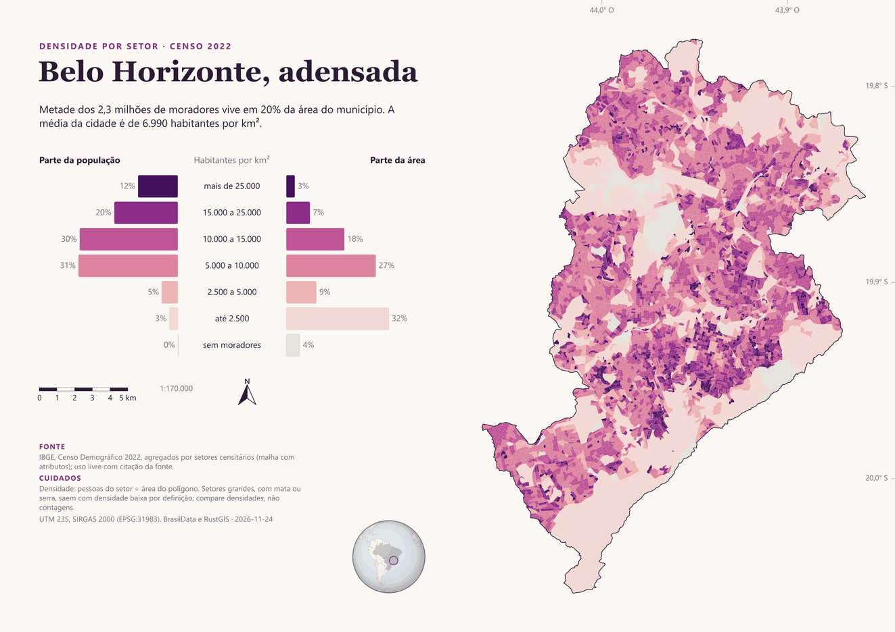

# Setores censitários (IBGE)

<!-- Gerado por scripts/gerar.py a partir do fontes.csv e do fichas.csv; não edite à mão. -->

Os setores censitários de 2022 com pessoas e domicílios: a menor unidade do Censo Demográfico.

*Mapa exemplo: Belo Horizonte (MG), com o dado do plugin e a folha feita à parte no RustGIS.*

| | |
|---|---|
| **Onde na aba** | Sociedade e economia › População |
| **Fonte** | IBGE |
| **Período** | Censo Demográfico 2022 (data de referência: 31/07/2022). |
| **Resolução ou escala** | setores censitários (de quarteirões nas cidades a dezenas de km² no campo). |
| **Unidades** | pessoas e domicílios (contagens); moradores por domicílio (média); área em km². |
| **Legenda** | Polígonos com os campos pessoas, domicilios, dom_particulares, dom_coletivos, media_moradores, prop_imputados e dom_part_ocupados (v0001 a v0007 do IBGE); o layout faz um mapa coroplético. |
| **Cuidados de uso** | Setores rurais grandes têm densidade baixa por definição; compare densidades (pessoas por km²), não contagens, entre setores de tamanhos diferentes. O arquivo do IBGE grava cada parte de um setor (ilha, pedaço separado) numa linha, com a população repetida; o plugin junta essas linhas, e cada setor é uma feição só. |
| **Licença** | uso livre com citação da fonte |
| **Citação** | IBGE, Censo Demográfico 2022, agregados por setores censitários (malha com atributos). |
| **App desktop** | sim |
| **App web** | sim, em dois cliques: o primeiro baixa o arquivo da UF, o segundo recorta. |

[Todas as camadas](README.md)
