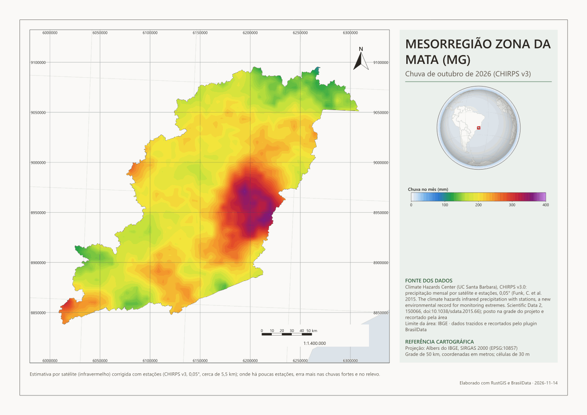

# Chuva do mês (CHIRPS v3)

<!-- Gerado por scripts/gerar.py a partir do fontes.csv e do fichas.csv; não edite à mão. -->

A chuva total de um mês, estimada por satélite (infravermelho) e corrigida com estações, do CHIRPS v3.0.

*Mapa exemplo: Zona da Mata (MG), feito com o plugin.*

| | |
|---|---|
| **Onde na aba** | Tempo e clima › Chuva observada |
| **Fonte** | Climate Hazards Center (Universidade da Califórnia em Santa Bárbara). |
| **Período** | um mês, de janeiro de 1981 até o último mês fechado (o total sai na terceira semana do mês seguinte). |
| **Resolução ou escala** | 0,05° (cerca de 5,5 km) |
| **Unidades** | mm no mês |
| **Legenda** | A escala da Chuva prevista, de 0 a 400 mm (a cor satura acima disso). |
| **Cuidados de uso** | É uma estimativa: onde há poucas estações, segue o satélite e erra mais nas chuvas fortes e no relevo. As falhas do satélite são preenchidas com o ERA5 (0,25°). Para o total de uma estação, use as séries da ANA ou do INMET. |
| **Licença** | licença não declarada no README da v3; o Climate Hazards Center distribui o CHIRPS como domínio público (CC0), com a citação. |
| **Citação** | Climate Hazards Center, CHIRPS v3.0 (Funk, C. et al. 2015. The climate hazards infrared precipitation with stations, a new environmental record for monitoring extremes. Scientific Data 2, 150066, doi:10.1038/sdata.2015.66). |
| **App desktop** | sim |
| **App web** | não: o servidor não aceita pedidos do app web. |

[Todas as camadas](README.md)
