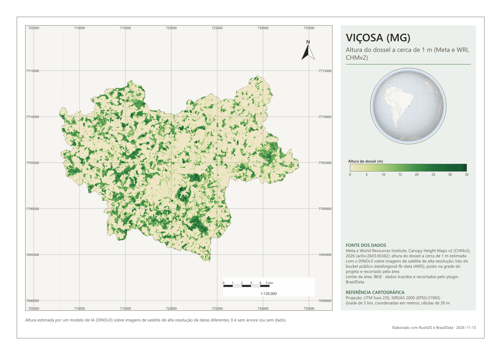

# Altura do dossel a 1 m (Meta CHMv2)

<!-- Gerado por scripts/gerar.py a partir do fontes.csv e do fichas.csv; não edite à mão. -->

A altura das árvores a cerca de 1 m, estimada por um modelo de IA (DINOv3) sobre imagens de satélite de alta resolução (Meta e WRI).

*Mapa exemplo: Viçosa (MG), feito com o plugin.*

| | |
|---|---|
| **Onde na aba** | Vegetação e meio ambiente › Vegetação |
| **Fonte** | Meta e World Resources Institute |
| **Período** | imagens de 2018 a 2024, de datas diferentes conforme o lugar. |
| **Resolução ou escala** | cerca de 1 m (tiles de zoom 17) |
| **Unidades** | metros |
| **Legenda** | Escala contínua de 0 (sem árvore) até a maior altura na área. |
| **Cuidados de uso** | Modelo de IA: subestima árvores muito altas e confunde prédios e sombras. O 0 vale também para sem dado. Use uma grade de 1 a 5 m numa área pequena. |
| **Licença** | CC BY 4.0 |
| **Citação** | Meta e World Resources Institute, Canopy Height Maps v2 (CHMv2), 2026. |
| **App desktop** | sim |
| **App web** | a confirmar (bucket da AWS) |

[Todas as camadas](README.md)
