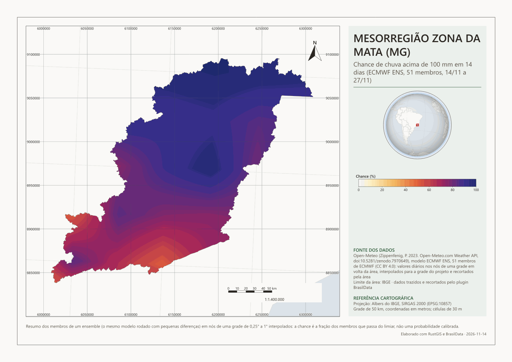

# Chuva do ensemble: chance e faixa provável (Open-Meteo)

<!-- Gerado por scripts/gerar.py a partir do fontes.csv e do fichas.csv; não edite à mão. -->

A chuva dos próximos dias nos membros de um ensemble de previsão (ECMWF ENS, ECMWF AIFS-ENS ou GEFS): a chance de passar de um limiar, a média dos membros ou os cenários seco (P10) e chuvoso (P90).

*Mapa exemplo: Zona da Mata (MG), feito com o plugin.*

| | |
|---|---|
| **Onde na aba** | Tempo e clima › Previsão |
| **Fonte** | Open-Meteo, com os ensembles do ECMWF e da NOAA. |
| **Período** | de hoje até 16 dias à frente (15 nos do ECMWF), da rodada mais recente do ensemble. |
| **Resolução ou escala** | nós de uma grade de 0,25° (0,5° no GEFS) em volta da área, mais abertos numa área grande (até 100 pontos), interpolados para a grade do projeto. |
| **Unidades** | % (a chance) ou mm (a média e os percentis). |
| **Legenda** | A chance: escala contínua de 0% (cinza-claro) a 100% (azul-escuro), passando pelo laranja e pelo vinho. A chuva: a escala da Chuva prevista. |
| **Cuidados de uso** | A chance é a fração dos membros que passa do limiar, não uma probabilidade calibrada: os ensembles costumam ser confiantes demais. O GEFS, a 0,5°, junta cidades vizinhas na mesma célula. A grade de pontos não vê o efeito do relevo local. |
| **Licença** | CC BY 4.0 (Open-Meteo; dados do ECMWF em CC BY 4.0, da NOAA em domínio público); a API gratuita do Open-Meteo é para uso não comercial. |
| **Citação** | Open-Meteo (Zippenfenig, P. 2023. Open-Meteo.com Weather API, doi:10.5281/zenodo.7970649), Ensemble API, com o ensemble escolhido: ECMWF ENS ou AIFS-ENS (ECMWF) ou GEFS (NOAA/NCEP). |
| **App desktop** | sim |
| **App web** | sim |

[Todas as camadas](README.md)
