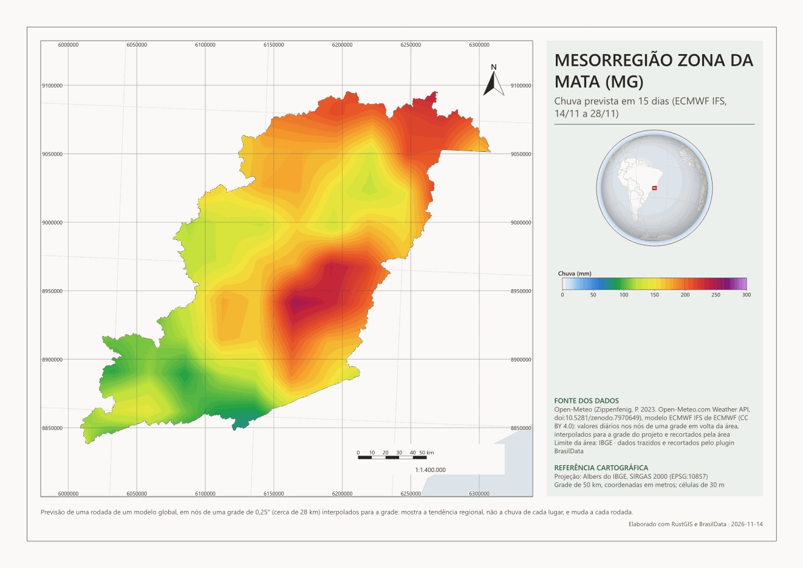

# Chuva prevista (Open-Meteo)

<!-- Gerado por scripts/gerar.py a partir do fontes.csv e do fichas.csv; não edite à mão. -->

A chuva prevista somada nos próximos dias por um modelo global de previsão do tempo (ECMWF IFS, ECMWF AIFS, GFS, ICON ou o melhor do Open-Meteo para o lugar).

*Mapa exemplo: Zona da Mata (MG), feito com o plugin.*

| | |
|---|---|
| **Onde na aba** | Tempo e clima › Previsão |
| **Fonte** | Open-Meteo, com os modelos do ECMWF, da NOAA e do DWD. |
| **Período** | de hoje até 16 dias à frente (15 nos modelos do ECMWF, 7 no ICON), da rodada mais recente do modelo; muda a cada rodada, de 6 em 6 ou de 12 em 12 horas. |
| **Resolução ou escala** | nós de uma grade de 0,25° (cerca de 28 km) em volta da área, mais abertos numa área grande (até 400 pontos), interpolados para a grade do projeto. |
| **Unidades** | mm |
| **Legenda** | Escala contínua do branco (sem chuva) ao azul, verde, amarelo, vermelho e roxo; a cor satura em 75 mm (até 3 dias), 150 mm (até 7), 200 mm (até 10) ou 300 mm. |
| **Cuidados de uso** | É uma previsão de uma rodada só: na segunda semana, uma rodada pode diferir da seguinte em mais de 50%; para a faixa provável, use a Chuva do ensemble. A grade de 28 km não vê a chuva de uma encosta nem de uma tempestade isolada. O dia de hoje entra inteiro, com as horas que já passaram tiradas da análise do modelo. |
| **Licença** | CC BY 4.0 (Open-Meteo; dados do ECMWF e do DWD em CC BY 4.0, da NOAA em domínio público); a API gratuita do Open-Meteo é para uso não comercial. |
| **Citação** | Open-Meteo (Zippenfenig, P. 2023. Open-Meteo.com Weather API, doi:10.5281/zenodo.7970649), com o modelo escolhido: ECMWF IFS ou AIFS (ECMWF), GFS (NOAA/NCEP) ou ICON (DWD). |
| **App desktop** | sim |
| **App web** | sim |

[Todas as camadas](README.md)
