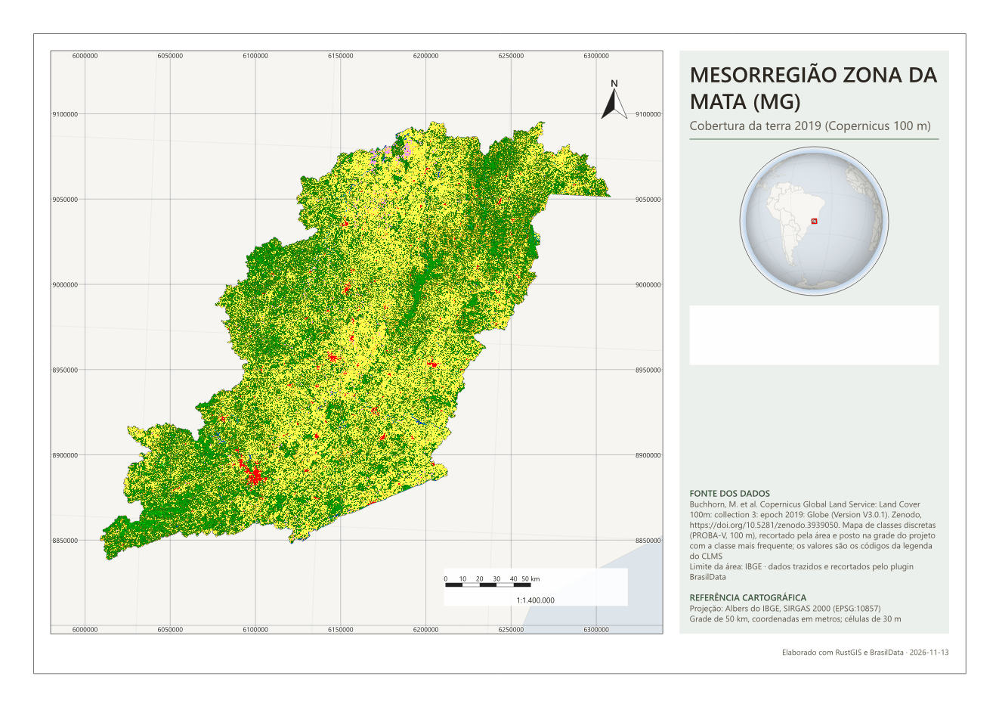

# Cobertura da terra 100 m (Copernicus)

<!-- Gerado por scripts/gerar.py a partir do fontes.csv e do fichas.csv; não edite à mão. -->

A cobertura da terra global do serviço de terra do Copernicus (CLMS Land Cover 100 m, coleção 3), feita com imagens do satélite PROBA-V.

*Mapa exemplo: Zona da Mata (MG), feito com o plugin.*

| | |
|---|---|
| **Onde na aba** | Vegetação e meio ambiente › Uso e cobertura. |
| **Fonte** | Copernicus Global Land Service (pelo Zenodo). |
| **Período** | um ano de 2015 a 2019 (2015 base; 2016 a 2018 consolidados; 2019 quase em tempo real). |
| **Resolução ou escala** | 1/1008° (cerca de 100 m), posta na grade do projeto com a classe mais frequente. |
| **Unidades** | códigos de classe da legenda do CLMS (valor do pixel). |
| **Legenda** | 23 classes nas cores oficiais: florestas fechadas e abertas (111 a 126), arbustos (20), vegetação herbácea (30), cultivos (40), área urbana (50), solo exposto (60), água (80), áreas úmidas (90)... |
| **Cuidados de uso** | Produto global de 100 m: a acurácia é de cerca de 80% no mundo e menor em mosaicos de pasto e mata como os da Mata Atlântica. Para o Brasil a 30 m e com anos recentes, o MapBiomas. |
| **Licença** | CC BY 4.0 |
| **Citação** | Buchhorn, M. et al., Copernicus Global Land Service: Land Cover 100m, collection 3, epoch 2015-2019, Globe (Zenodo). |
| **App desktop** | sim |
| **App web** | sim (lido do Zenodo; precisa de um RustGIS depois da 0.5.0). |

[Todas as camadas](README.md)
