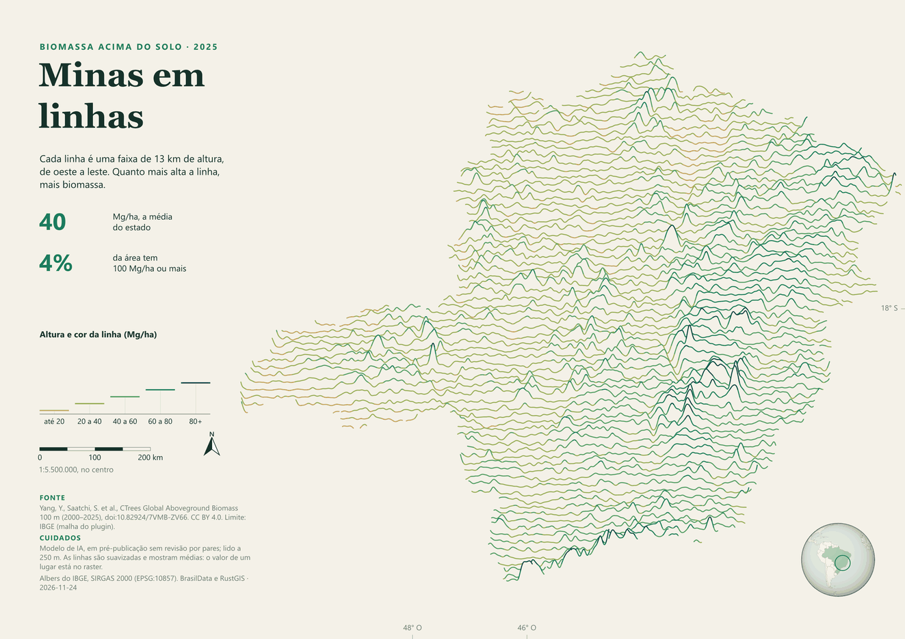

# Biomassa acima do solo por ano (CTrees, 100 m)

<!-- Gerado por scripts/gerar.py a partir do fontes.csv e do fichas.csv; não edite à mão. -->

A biomassa acima do solo a 100 m, num ano de 2000 a 2025, estimada pela CTrees com um modelo de IA (DenseNet) calibrado com biomassa de lidar aéreo e de parcelas de campo, a partir de séries do Landsat, do radar ALOS PALSAR-2 e das alturas do GEDI e do ICESat-2; ou a incerteza do mapa (o erro-padrão).

*Mapa exemplo: Minas Gerais, com o dado do plugin e a folha feita à parte no RustGIS.*

| | |
|---|---|
| **Onde na aba** | Vegetação e meio ambiente › Vegetação |
| **Fonte** | CTrees |
| **Período** | um ano de 2000 a 2025 |
| **Resolução ou escala** | 1/1125° (cerca de 100 m); numa área grande, a pirâmide do arquivo (200 m, 400 m...). |
| **Unidades** | Mg/ha (toneladas de matéria seca por hectare). |
| **Legenda** | Escala contínua do bege (sem biomassa) ao verde-azulado escuro, de 0 a 400 Mg/ha; a incerteza, do bege ao vinho, de 0 a 100 Mg/ha. |
| **Cuidados de uso** | Modelo de IA, em pré-publicação sem revisão por pares. A diferença entre dois anos só vale onde passa da incerteza. Para comparar com o laser, a biomassa do GEDI (2019 a 2023, 30 m). |
| **Licença** | CC BY 4.0 |
| **Citação** | Yang, Y., Saatchi, S. et al., CTrees Global Aboveground Biomass 100 m (2000–2025), doi:10.82924/7VMB-ZV66; pré-publicação na EarthArXiv, doi:10.31223/X5KJ4Q. |
| **App desktop** | sim |
| **App web** | sim (o bucket da AWS libera a leitura pelo navegador); precisa de um RustGIS depois da 0.5.0. |

[Todas as camadas](README.md)
