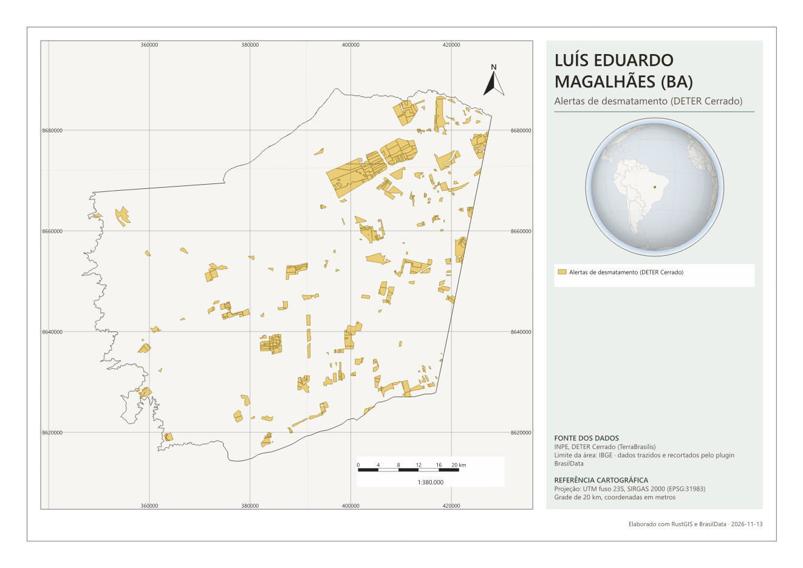

# Alertas de desmatamento (DETER Cerrado)

<!-- Gerado por scripts/gerar.py a partir do fontes.csv e do fichas.csv; não edite à mão. -->

Os alertas de desmatamento do DETER no Cerrado: avisos diários do INPE de vegetação suprimida.

*Mapa exemplo: Luís Eduardo Magalhães (BA), feito com o plugin.*

| | |
|---|---|
| **Onde na aba** | Vegetação e meio ambiente › Desmatamento |
| **Fonte** | INPE |
| **Período** | de 2018 até a véspera |
| **Resolução ou escala** | imagens de 20 a 64 m (CBERS, Amazonia-1); área mínima de 1 ha. |
| **Unidades** | área em km² |
| **Legenda** | Polígonos pela classe do alerta e pela data. |
| **Cuidados de uso** | Alerta rápido para a fiscalização, não estatística: a área oficial é a do PRODES. Inclui degradação, cicatrizes de fogo e mineração, além do corte raso. |
| **Licença** | CC BY-SA 4.0 |
| **Citação** | INPE, DETER Cerrado (TerraBrasilis) |
| **App desktop** | sim |
| **App web** | sim |

[Todas as camadas](README.md)
