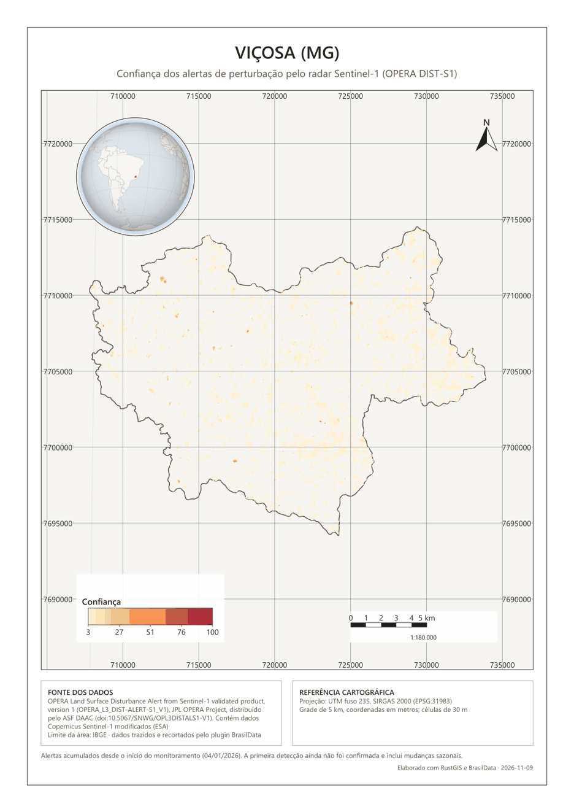

# Perturbação da vegetação: confiança (OPERA DIST-S1)

<!-- Gerado por scripts/gerar.py a partir do fontes.csv e do fichas.csv; não edite à mão. -->

A confiança do alerta de perturbação, que cresce a cada passagem que a confirma.

*Mapa exemplo: Viçosa (MG), feito com o plugin.*

| | |
|---|---|
| **Onde na aba** | Vegetação e meio ambiente › Desmatamento |
| **Fonte** | NASA/JPL OPERA (ASF DAAC); Sentinel-1 da ESA. |
| **Período** | desde 04/01/2026 |
| **Resolução ou escala** | 30 m |
| **Unidades** | índice de confiança (sem unidade) |
| **Legenda** | Escala contínua. |
| **Cuidados de uso** | Alerta automático de mudança no sinal do radar: desmatamento, queimada, colheita de eucalipto e até inundação aparecem como perturbação. Confirme nas imagens. Pede o login Earthdata. |
| **Licença** | dados da NASA sem restrição de uso, com citação; dados Copernicus Sentinel de uso livre e gratuito. |
| **Citação** | OPERA DIST-ALERT-S1 V1, JPL OPERA Project, ASF DAAC, doi:10.5067/SNWG/OPL3DISTALS1-V1; contém dados Copernicus Sentinel-1 modificados. |
| **App desktop** | sim |
| **App web** | No app web: depende do login Earthdata, que o RustGIS guarda no desktop; ainda não testado no web. |

[Todas as camadas](README.md)
