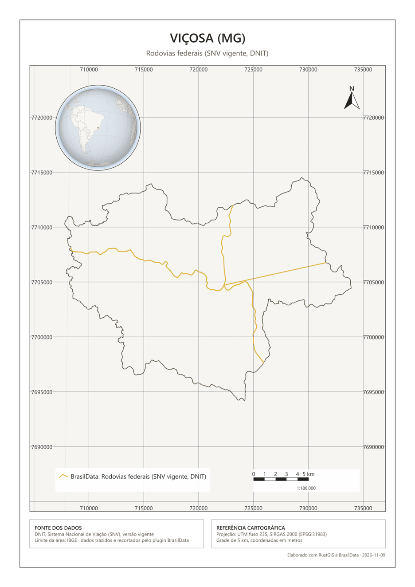

# Rodovias federais (SNV vigente, DNIT)

<!-- Gerado por scripts/gerar.py a partir do fontes.csv e do fichas.csv; não edite à mão. -->

As rodovias federais do Sistema Nacional de Viação.

*Mapa exemplo: Viçosa (MG), feito com o plugin.*

| | |
|---|---|
| **Onde na aba** | Infraestrutura › Transportes |
| **Fonte** | DNIT |
| **Período** | versão do SNV vigente |
| **Resolução ou escala** | escala regional (eixo das rodovias) |
| **Unidades** | extensão em km; quilometragem inicial e final. |
| **Legenda** | Linhas pela superfície (pavimentada, em obras, planejada...), com a BR, o código do trecho e os locais de início e fim. |
| **Cuidados de uso** | Só as federais (as BRs, inclusive as delegadas); as estaduais e municipais não estão. |
| **Licença** | sem restrições declaradas |
| **Citação** | DNIT, Sistema Nacional de Viação (SNV), versão vigente. |
| **App desktop** | sim |
| **App web** | sim |

[Todas as camadas](README.md)
