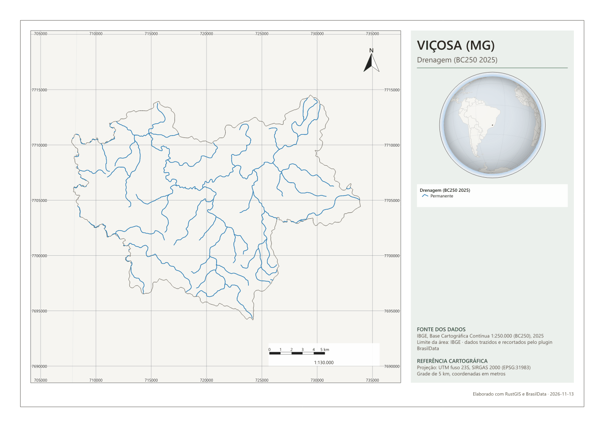

# Drenagem (BC250 2025)

<!-- Gerado por scripts/gerar.py a partir do fontes.csv e do fichas.csv; não edite à mão. -->

Os rios e córregos da Base Cartográfica Contínua do IBGE, com a ordem de Strahler e a drenagem a montante de cada trecho, calculadas pelo BrasilData na rede do país inteiro.

*Mapa exemplo: Viçosa (MG), feito com o plugin.*

| | |
|---|---|
| **Onde na aba** | Água › Hidrografia |
| **Fonte** | IBGE |
| **Período** | BC250, edição 2025 |
| **Resolução ou escala** | escala 1:250.000 |
| **Unidades** | drenagem a montante (montante_km) e comprimento do trecho (comp_km) em km; ordem de Strahler de 1 a 10. |
| **Legenda** | Linhas azuis, mais grossas quanto maior a ordem de Strahler, com os nomes dos rios (os dos rios com mais drenagem a montante têm a preferência). De longe aparecem só os rios com mais drenagem a montante; de 1:300.000 para perto, todos os trechos. |
| **Cuidados de uso** | Na escala 1:250.000 faltam os córregos pequenos; para a rede detalhada, os trechos da BHO da ANA (1:50.000 em parte do país). O sentido da corrente vem da ligação entre os trechos, não de como foram digitalizados (o campo contra_corrente marca os 271 mil trechos digitalizados ao contrário). Numa área de mais de 6 UFs, ou sem área, vem o país inteiro, lido pela vista e sem recorte. |
| **Licença** | uso livre com citação da fonte |
| **Citação** | IBGE, Base Cartográfica Contínua 1:250.000 (BC250), 2025; ordem de Strahler e drenagem a montante: BrasilData. |
| **App desktop** | sim |
| **App web** | sim |

[Todas as camadas](README.md)
