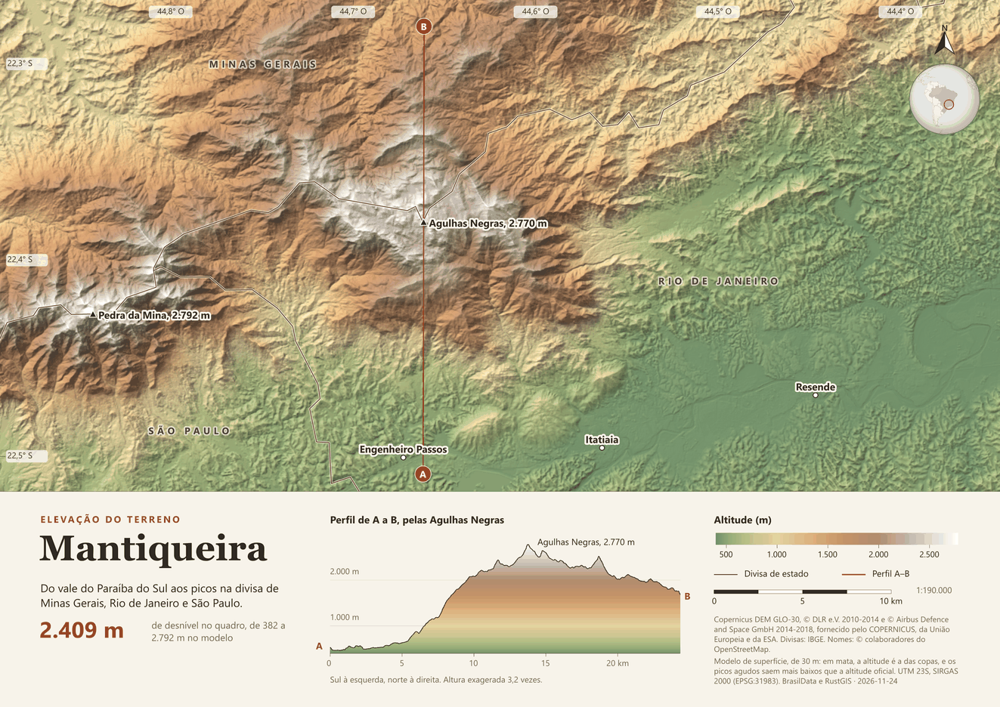

# Elevação (Copernicus GLO-30)

<!-- Gerado por scripts/gerar.py a partir do fontes.csv e do fichas.csv; não edite à mão. -->

O modelo digital de superfície Copernicus GLO-30: a altitude do terreno com a vegetação e as construções.

*Mapa exemplo: Serra da Mantiqueira (MG, RJ e SP), com o dado do plugin e a folha feita à parte no RustGIS.*

| | |
|---|---|
| **Onde na aba** | Meio físico › Relevo |
| **Fonte** | Copernicus (DLR e Airbus), pela OpenTopography. |
| **Período** | dados do TanDEM-X de 2011 a 2015 |
| **Resolução ou escala** | 1″ (cerca de 30 m) |
| **Unidades** | metros, no geoide EGM2008 |
| **Legenda** | Escala contínua de cores (com relevo sombreado no layout). |
| **Cuidados de uso** | É um modelo de superfície: em mata, a altitude é a das copas. Erros maiores em vales encaixados e áreas de sombra do radar. |
| **Licença** | licença do Copernicus DEM: uso livre e gratuito, com esta citação. |
| **Citação** | Copernicus DEM GLO-30, © DLR e.V. 2010-2014 e © Airbus Defence and Space GmbH 2014-2018, provided under COPERNICUS by the European Union and ESA. |
| **App desktop** | sim |
| **App web** | não: o servidor dos tiles não aceita pedidos do app web. |

[Todas as camadas](README.md)
