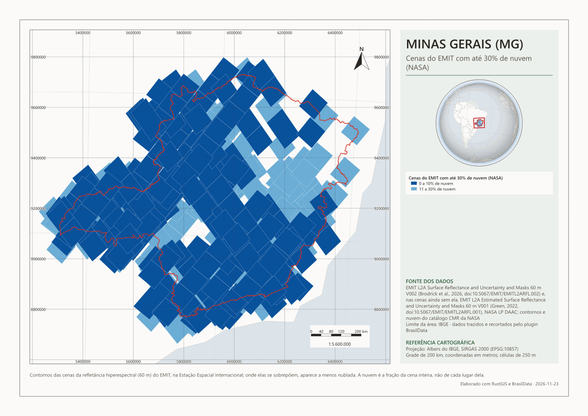

# Cenas hiperespectrais do EMIT (NASA)

<!-- Gerado por scripts/gerar.py a partir do fontes.csv e do fichas.csv; não edite à mão. -->

Onde há cena do EMIT, o espectrômetro de imagem da NASA na Estação Espacial Internacional: o contorno, a data, a nuvem e os endereços de cada cena da refletância hiperespectral da superfície.

*Mapa exemplo: Minas Gerais, feito com o plugin.*

| | |
|---|---|
| **Onde na aba** | Vegetação e meio ambiente › Uso e cobertura. |
| **Fonte** | NASA/JPL e LP DAAC |
| **Período** | de agosto de 2022 em diante, todos os anos ou um só. |
| **Resolução ou escala** | contornos das cenas (cerca de 80 km de lado); a imagem tem 60 m e 285 bandas, de 381 a 2.493 nm. |
| **Unidades** | nuvem da cena, em % |
| **Legenda** | Azul-escuro, até 10% de nuvem; azul, de 11 a 30%; azul-claro, de 31 a 50%; cinza, mais de 50%. Campos: cena, data, hora (UTC), ano, nuvem, classe, versão, prévia e arquivo. |
| **Cuidados de uso** | É a lista das cenas, não a imagem: cada arquivo é um netCDF de quase 2 GB, que pede o login Earthdata e o plugin não lê. A nuvem é a fração da cena inteira, não da área, e as máscaras das versões 001 e 002 discordam: em cada cena vale a 002, se houver. O contorno é o do catálogo, simplificado. A órbita da Estação não repete a passagem em intervalos fixos. |
| **Licença** | dados da NASA de uso livre e aberto, com citação. |
| **Citação** | EMIT L2A Surface Reflectance and Uncertainty and Masks 60 m V002, doi:10.5067/EMIT/EMITL2ARFL.002, e V001, doi:10.5067/EMIT/EMITL2ARFL.001, NASA LP DAAC. |
| **App desktop** | sim |
| **App web** | No app web: o catálogo da NASA aceita pedidos do app web; ainda não testado no web. |

[Todas as camadas](README.md)
