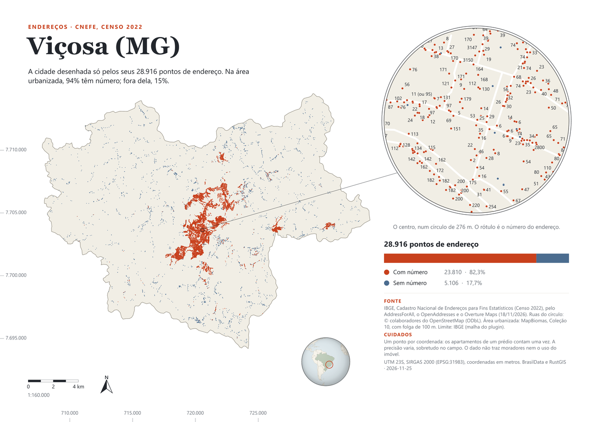

# Endereços (IBGE, CNEFE 2022)

<!-- Gerado por scripts/gerar.py a partir do fontes.csv e do fichas.csv; não edite à mão. -->

Um ponto por endereço do Censo 2022 (o Cadastro Nacional de Endereços para Fins Estatísticos do IBGE), com a rua, o número e o CEP: 89,9 milhões no país.

*Mapa exemplo: Viçosa (MG), feito com o plugin.*

| | |
|---|---|
| **Onde na aba** | Infraestrutura › Edificações |
| **Fonte** | IBGE (CNEFE do Censo 2022), pelo Overture Maps Foundation. |
| **Período** | Censo Demográfico 2022, na versão mais recente do tema de endereços do Overture Maps (as versões saem todo mês). |
| **Resolução ou escala** | um ponto por endereço (coordenada do CNEFE). |
| **Unidades** | sem unidade (pontos) |
| **Legenda** | Duas cores: endereço com número (vermelho) e sem número (cinza). O número é o rótulo de 1:3.000 para perto. |
| **Cuidados de uso** | Só de 1:50.000 para perto: o RustGIS lê até 60 mil pontos por vista. Não é recortada: a camada é mascarada pelo contorno da área, e mostra o que a vista mostra. Um ponto por coordenada: os apartamentos de um prédio contam uma vez. O município e o bairro não vêm (o RustGIS deixa de fora as listas do Overture). A qualidade da coordenada varia, sobretudo no campo. O dado não tem moradores nem o uso do imóvel. |
| **Licença** | dados abertos do IBGE, com citação da fonte (a página de atribuição do Overture diz CC0). |
| **Citação** | IBGE, Censo Demográfico 2022, Cadastro Nacional de Endereços para Fins Estatísticos (CNEFE), processado pelo AddressForAll e pelo OpenAddresses; tema de endereços do Overture Maps Foundation. |
| **App desktop** | sim |
| **App web** | ainda não testado no web (o bucket do Overture libera a leitura pelo navegador); precisa de um RustGIS que leia GeoParquet no lugar (0.7.0). |

[Todas as camadas](README.md)
