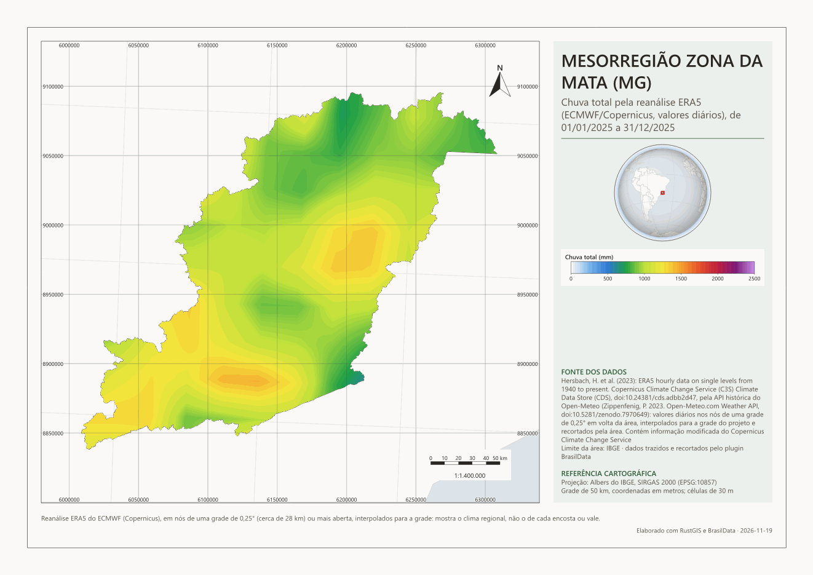

# Chuva do ERA5 (reanálise, desde 1940)

<!-- Gerado por scripts/gerar.py a partir do fontes.csv e do fichas.csv; não edite à mão. -->

A chuva de um período passado na reanálise ERA5 do ECMWF: o total do período ou a média por ano.

*Mapa exemplo: Zona da Mata (MG), feito com o plugin.*

| | |
|---|---|
| **Onde na aba** | Tempo e clima › Clima passado (ERA5) |
| **Fonte** | ECMWF (Copernicus Climate Change Service), pelo Open-Meteo. |
| **Período** | desde 01/01/1940, por dia, até uns 5 dias atrás; até 30 anos num município, uns 500 dias em Minas Gerais inteira. |
| **Resolução ou escala** | nós de uma grade de 0,25° (cerca de 28 km) em volta da área, mais abertos (até 1°) num período longo ou numa área grande, interpolados para a grade do projeto. |
| **Unidades** | mm (total) ou mm por ano |
| **Legenda** | Escala contínua do branco ao azul, verde, amarelo, vermelho e roxo; a cor satura em 2.500 mm por ano, ou no total proporcional à duração do período. |
| **Cuidados de uso** | A reanálise subestima os temporais e erra mais a chuva que a temperatura, sobretudo no relevo acidentado: compare com as estações da ANA ou do INMET. A grade de 28 km não vê o efeito de uma serra. |
| **Licença** | licença do Copernicus (C3S): uso livre, com a citação; Open-Meteo em CC BY 4.0, e a API gratuita é para uso não comercial. |
| **Citação** | Hersbach, H. et al. (2023): ERA5 hourly data on single levels from 1940 to present. Copernicus Climate Change Service (C3S) Climate Data Store (CDS), doi:10.24381/cds.adbb2d47, pela API histórica do Open-Meteo (Zippenfenig, P. 2023, doi:10.5281/zenodo.7970649). Contém informação modificada do Copernicus Climate Change Service. |
| **App desktop** | sim |
| **App web** | sim |

[Todas as camadas](README.md)
