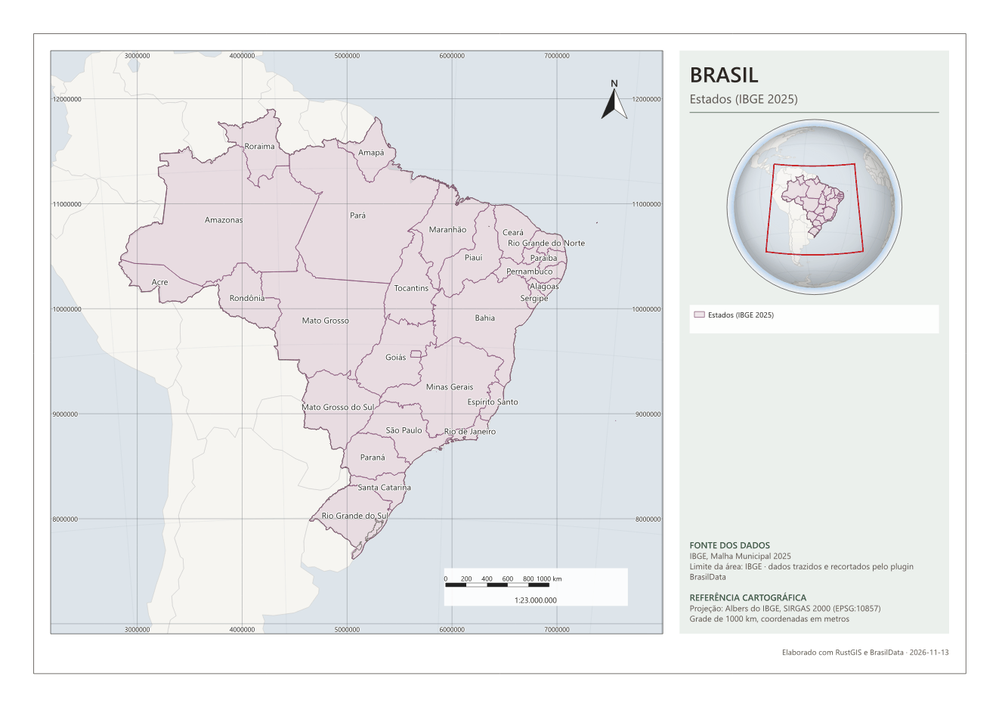

# Estados (IBGE 2025)

<!-- Gerado por scripts/gerar.py a partir do fontes.csv e do fichas.csv; não edite à mão. -->

As 27 unidades da federação.

*Mapa exemplo: Brasil, feito com o plugin.*

| | |
|---|---|
| **Onde na aba** | Território › Limites |
| **Fonte** | IBGE |
| **Período** | Malha Municipal 2025 do IBGE (a divisão vigente em 2025). |
| **Resolução ou escala** | escala 1:250.000 |
| **Unidades** | sem unidade (polígonos); área em km² quando há o campo area_km2. |
| **Legenda** | Um polígono por UF, com o código e o nome (cd_uf, nm_uf). |
| **Cuidados de uso** | Limites para mapas e estatística, não para demarcação legal. Vem o polígono inteiro de cada unidade que cruza a área, sem recorte. |
| **Licença** | uso livre com citação da fonte |
| **Citação** | IBGE, Malha Municipal 2025 |
| **App desktop** | sim |
| **App web** | sim |

[Todas as camadas](README.md)
