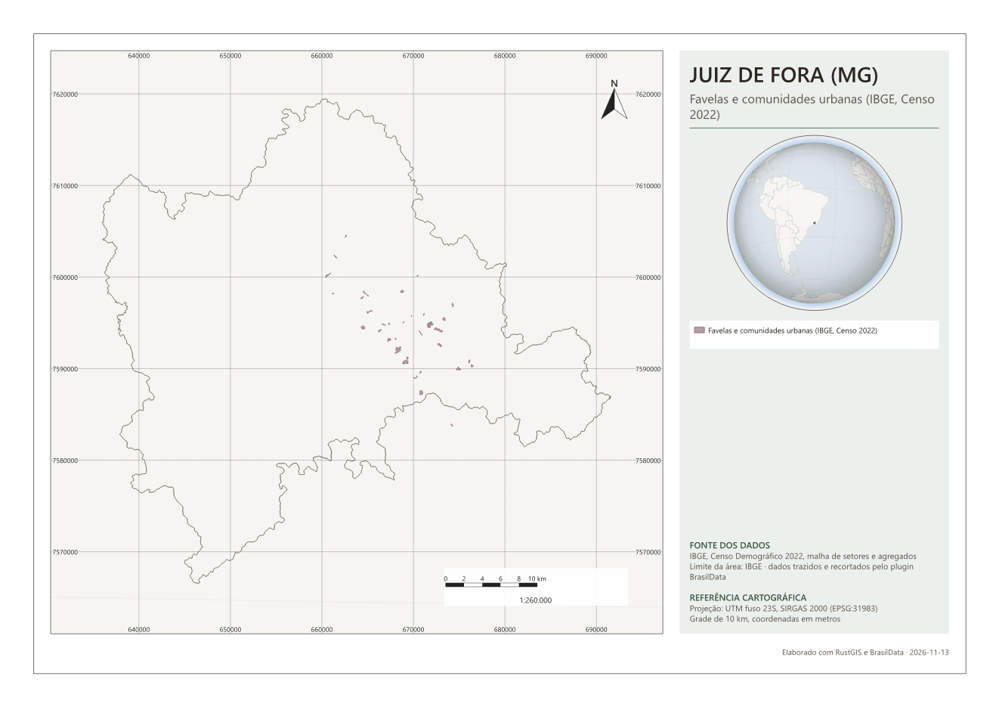

# Favelas e comunidades urbanas (IBGE, Censo 2022)

<!-- Gerado por scripts/gerar.py a partir do fontes.csv e do fichas.csv; não edite à mão. -->

As favelas e comunidades urbanas do Censo 2022 (antes chamadas aglomerados subnormais).

*Mapa exemplo: Juiz de Fora (MG), feito com o plugin.*

| | |
|---|---|
| **Onde na aba** | Sociedade e economia › População |
| **Fonte** | IBGE |
| **Período** | malha do Censo Demográfico 2022 |
| **Resolução ou escala** | escala cadastral dos setores censitários |
| **Unidades** | sem unidade |
| **Legenda** | Polígonos com o código e o nome da comunidade. |
| **Cuidados de uso** | Delimitação do IBGE para o Censo; os nomes e limites locais podem diferir. |
| **Licença** | uso livre com citação da fonte |
| **Citação** | IBGE, Censo Demográfico 2022, malha de setores e agregados. |
| **App desktop** | sim |
| **App web** | sim |

[Todas as camadas](README.md)
