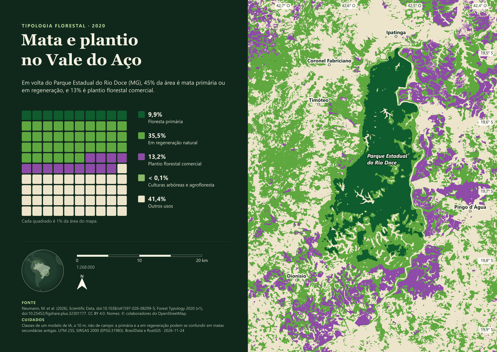

# Tipologia florestal 2020 a 10 m (ForTy)

<!-- Gerado por scripts/gerar.py a partir do fontes.csv e do fichas.csv; não edite à mão. -->

O tipo de floresta em 2020 a 10 m, do Forest Typology (ForTy): floresta primária, em regeneração natural, plantada, plantio florestal comercial, culturas arbóreas e agrofloresta, e outros usos, por um modelo de IA sobre imagens de satélite (Google DeepMind, WRI e IIASA).

*Mapa exemplo: Vale do Aço (MG), com o dado do plugin e a folha feita à parte no RustGIS.*

| | |
|---|---|
| **Onde na aba** | Vegetação e meio ambiente › Vegetação |
| **Fonte** | Nature Trace (Google DeepMind e Google Research), com o WRI e o IIASA. |
| **Período** | 2020 (a data de corte do regulamento europeu contra o desmatamento, EUDR). |
| **Resolução ou escala** | 10 m, em blocos de cerca de 33 × 45 km; numa grade mais grossa, a pirâmide do arquivo (de 20 a 640 m). |
| **Unidades** | classe (valor do pixel, de 1 a 6) |
| **Legenda** | Seis classes: 1 floresta primária (verde-escuro), 2 em regeneração natural (verde), 3 plantada (verde-claro), 4 plantio florestal comercial (roxo), 5 culturas arbóreas e agrofloresta (laranja), 6 outros usos (bege). |
| **Cuidados de uso** | Classes de um modelo de IA, não de campo: a floresta primária e a em regeneração podem se confundir em matas secundárias antigas, e a vegetação lenhosa esparsa (como o cerrado ralo) e as árvores urbanas entram em outros usos. Para o uso da terra no Brasil ano a ano, o MapBiomas. Até 16 blocos por clique. |
| **Licença** | CC BY 4.0 |
| **Citação** | Neumann, M. et al., Global forest typology at 10-meter resolution for forest and land-use monitoring, Scientific Data (2026), doi:10.1038/s41597-026-08299-5; Forest Typology 2020 (v1), Figshare+, doi:10.25452/figshare.plus.32301177. |
| **App desktop** | sim |
| **App web** | não (o bucket do Google não libera a leitura pelo navegador); só no app desktop e no rustgis-cli. |

[Todas as camadas](README.md)
