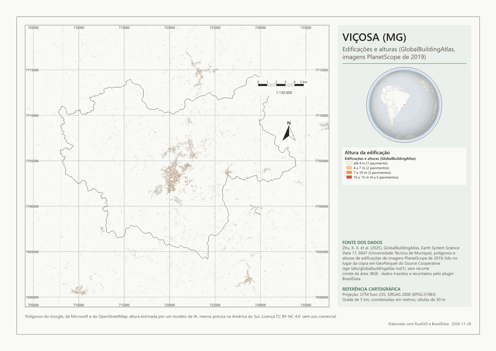

# Edificações e alturas (GlobalBuildingAtlas)

<!-- Gerado por scripts/gerar.py a partir do fontes.csv e do fichas.csv; não edite à mão. -->

O polígono de cada edificação com a altura estimada, do GlobalBuildingAtlas (Universidade Técnica de Munique): polígonos do Google, da Microsoft e do OpenStreetMap, alturas de um modelo de IA sobre imagens PlanetScope.

*Mapa exemplo: Viçosa (MG), feito com o plugin.*

| | |
|---|---|
| **Onde na aba** | Infraestrutura › Edificações |
| **Fonte** | Universidade Técnica de Munique (GlobalBuildingAtlas). |
| **Período** | 2019 (imagens PlanetScope; 2018 onde faltou imagem sem nuvem). |
| **Resolução ou escala** | o polígono de cada edificação; alturas de imagens de 3 m. |
| **Unidades** | metros (campo height); var é a variância da altura. |
| **Legenda** | Seis classes de altura, do bege (até 4 m, 1 pavimento) ao vinho (mais de 25 m). |
| **Cuidados de uso** | Na América do Sul, o erro médio da altura passa de 8 m e ela tende a sair baixa. A camada é lida no lugar e mostra o que a vista mostra, sem recorte pela área. Sem uso comercial (CC BY-NC 4.0). |
| **Licença** | CC BY-NC 4.0 (sem uso comercial); os polígonos do OpenStreetMap, ODbL. |
| **Citação** | Zhu, X. X. et al. (2025), GlobalBuildingAtlas, Earth System Science Data 17, 6647. |
| **App desktop** | sim |
| **App web** | sim (o Source Cooperative libera a leitura pelo navegador); precisa de um RustGIS que leia GeoParquet no lugar. |

[Todas as camadas](README.md)
