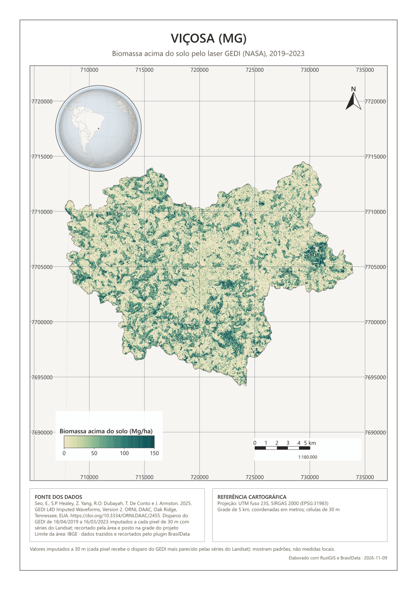

# Biomassa acima do solo (GEDI)

<!-- Gerado por scripts/gerar.py a partir do fontes.csv e do fichas.csv; não edite à mão. -->

A densidade de biomassa acima do solo, do modelo do GEDI L4A.

*Mapa exemplo: Viçosa (MG), feito com o plugin.*

| | |
|---|---|
| **Onde na aba** | Vegetação e meio ambiente › Vegetação |
| **Fonte** | NASA (ORNL DAAC) |
| **Período** | disparos de 18/04/2019 a 16/03/2023 |
| **Resolução ou escala** | 30 m |
| **Unidades** | Mg/ha (toneladas por hectare) |
| **Legenda** | Escala contínua de cores. |
| **Cuidados de uso** | Os disparos do laser cobrem só faixas; o valor de cada pixel é imputado das séries do Landsat, com mais erro longe dos disparos e em relevo íngreme. Pede o login Earthdata. A biomassa vem de modelos por tipo de vegetação, com incerteza de 30 a 50% num pixel. |
| **Licença** | política de dados da NASA: uso livre e gratuito, com a citação. |
| **Citação** | Seo et al. 2025, GEDI L4D Imputed Waveforms, Version 2, ORNL DAAC, doi:10.3334/ORNLDAAC/2455. |
| **App desktop** | sim |
| **App web** | No app web: depende do login Earthdata, que o RustGIS guarda no desktop; ainda não testado no web. |

[Todas as camadas](README.md)
